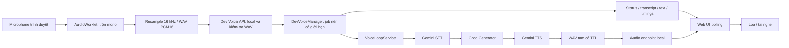
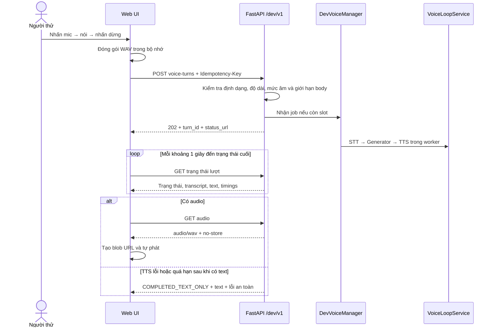
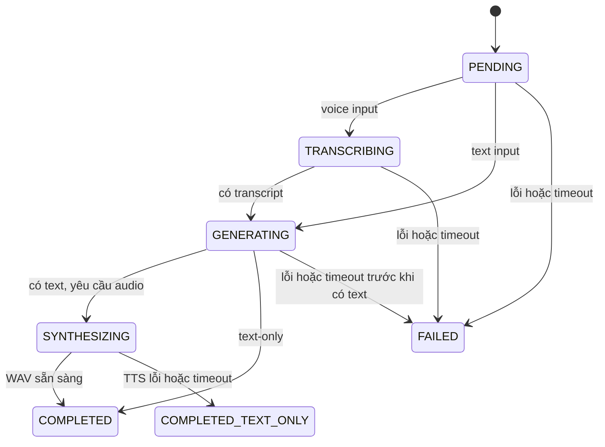

# Dev Voice API và Web UI local

## 1. Mục đích và phạm vi

Backend hiện cung cấp một API demo thật cho luồng nghe → trả lời → nói, cùng trang web
đơn giản để thử trên máy trước khi tích hợp mobile. Trang web và mobile thử nghiệm có
thể dùng cùng hợp đồng `/dev/v1`.

Người dùng nhấn mic để nói, nhấn lần nữa để dừng. Trang web tự đóng gói bản ghi, gửi
đến API, theo dõi trạng thái và phát phản hồi. Không phải chọn file audio thủ công.
Đây là hội thoại theo từng lượt: hệ thống bắt đầu STT khi đã nhận bản ghi hoàn chỉnh.
Chưa có streaming, ngắt lời, VAD hay trí nhớ giữa các lượt.

Mọi kết quả thuộc `mode=voice_demo`; câu trả lời luôn có
`verification_status=NOT_RUN`. Luồng này chưa chạy RAG, web search, Supabase, Game
Backend hay Verifier. Nếu hỏi lore/game state, prompt hiện yêu cầu nói rõ chưa có
thông tin được xác minh. Quy tắc TTS chỉ phát câu trả lời đã duyệt của pipeline game
không áp dụng cho demo tách biệt này.

Các route `/v1` cũ vẫn là bộ khung mock của pipeline được kiểm chứng. Chúng không tự
chuyển thành route gọi provider thật khi bật demo.

## 2. Cài đặt và chạy

Chạy từ thư mục `D:\Saigon-Veilwake\saigon-veilwake-ai`, dùng Python 3.10+ và venv hiện có:

```powershell
.\.venv\Scripts\Activate.ps1
python -m pip install -e ".[dev]"
```

Dùng `python -m pip` để tránh gọi launcher `pip.exe` bị Application Control chặn trên
máy này. Không cần Node, npm, FFmpeg hoặc server frontend để chạy trang web; Node chỉ
dùng cho bộ kiểm thử JavaScript tùy chọn.

Giữ các key/model đang hoạt động trong `.env`:

```dotenv
GEMINI_API_KEY=
GROQ_GENERATOR_API_KEY=
GROQ_GENERATOR_MODEL=
GEMINI_STT_MODEL=gemini-3.5-transcribe
GEMINI_TTS_MODEL=gemini-3.8-flash-lite-tts
```

Thêm hoặc cập nhật các biến sau trong `.env` hiện có, không chép đè file đang chứa key:

```dotenv
SVAI_APP_ENV=development
DEV_VOICE_ENABLED=true
```

Demo local không yêu cầu mã truy cập. Khởi động sẽ báo tên biến provider bị thiếu nếu
cấu hình chưa đủ; không gọi provider để kiểm tra key lúc khởi động. Cấu hình đầy đủ
không đảm bảo key/model còn quota hoặc có quyền truy cập.

```powershell
python -m uvicorn app.main:app --host 127.0.0.1 --port 8000 --workers 1
```

Mở **http://127.0.0.1:8000/dev/**. Có thể dùng `http://localhost:8000/dev/` trên máy
này. Dùng một địa chỉ xuyên suốt phiên để quyền mic của trình duyệt nhất quán.
Không mở `index.html` trực tiếp. API và UI cùng origin nên không cần cấu hình CORS.

Chỉ chạy **một worker**, không bật `--reload` trong lúc thử. Metadata job nằm trong RAM
của tiến trình; nhiều worker hoặc restart giữa lượt sẽ làm việc đọc trạng thái không
nhất quán hoặc mất lượt. Dừng server bằng `Ctrl+C`.

## 3. Thử trên trình duyệt

1. Nhấn **Kết nối** để tạo phiên thử nghiệm local.
2. Nhấn **Nhấn để nói**. Cho phép microphone khi trình duyệt hỏi.
3. Nói rõ ít nhất một giây. Nhấn dừng, hoặc chờ tự dừng sau 30 giây.
4. Trang tự gửi WAV và lần lượt hiển thị nhận dạng, tạo câu trả lời, tạo giọng.
5. Đọc transcript, câu trả lời và thời gian STT/LLM/TTS. Audio được tự phát khi sẵn sàng.
   Nếu trình duyệt chặn autoplay, dùng nút phát trên thanh audio.

Có thể mở **Hoặc thử bằng văn bản** để kiểm tra LLM → TTS mà không dùng mic. Bỏ chọn
**Nhận phản hồi bằng giọng nói** để chạy text-only, không gọi TTS. Gửi text không gọi
STT; gửi voice vẫn cần STT dù chọn phản hồi text-only.

Khi mạng gián đoạn, nút thử lại tiếp tục cùng `turn_id` hoặc gửi lại cùng
`Idempotency-Key`, nội dung và response mode. Không tạo lượt mới chỉ để lấy lại kết
quả cũ. Nếu chỉ tải audio lỗi, **Tải lại audio** thử tải lại kết quả đã tạo, không gọi
TTS lần nữa. Sau khi audio hết hạn, cần một lượt mới nếu muốn tạo giọng mới.

**Ngắt kết nối** dừng mic và hủy việc chờ ở client. Lượt đã gửi có thể vẫn chạy trên
server đến khi hoàn tất/timeout. Reload trang cần tạo lại phiên. Bản ghi được giữ
trong RAM client khi cần gửi lại, rồi giải phóng tham chiếu khi hoàn tất/ngắt kết nối.

Mọi request local dùng cùng một caller demo, không có đăng nhập hoặc cách ly tài khoản.
Các tiến trình trên máy có thể truy cập kết quả nếu biết ID lượt. Chế độ này chỉ dùng
để thử local; cần thiết kế auth và quyền riêng trước khi tích hợp mobile qua mạng.

## 4. Kiến trúc





Code chính:

| File | Trách nhiệm |
| --- | --- |
| `app/api/dev_voice.py` | Routes, nhận WAV và trả DTO demo |
| `app/core/dev_voice_http.py` | Chỉ cho phép development và kết nối loopback, giới hạn body, headers UI |
| `app/schemas/dev_voice.py` | Request/response riêng, không dùng default PASS của schema game |
| `app/modules/voice_loop/dev_api.py` | Job local, idempotency, thread pool, trạng thái, watchdog, TTL, dọn file |
| `app/modules/voice_loop/service.py` | Orchestration dùng chung với CLI; progress callback, text-only, lỗi TTS không làm mất text |
| `app/integrations/stt_providers/gemini_stt.py` | Adapter Gemini STT hiện có |
| `app/integrations/llm/groq_generator.py` | Adapter Groq và prompt voice demo |
| `app/integrations/tts_providers/gemini_tts.py` | Adapter Gemini TTS; bọc PCM thành WAV nếu cần |
| `app/web/dev_voice/` | HTML/CSS/JS, recorder, worklet, polling, playback |
| `app/main.py` | App factory, khởi tạo/dọn manager theo lifespan |

Các file cấu hình/tài liệu được cập nhật: `app/core/config.py`, `.env.example`,
`pyproject.toml` (đóng gói static assets), `README.md` và proposal v1.3. Web assets mới
gồm `index.html`, `style.css`, `app.js`, `audio.js`, `pcm-worklet.js`. Test mới nằm ở
`tests/test_dev_voice_api.py`, `tests/js/voice_audio.test.mjs` và
`tests/js/voice_ui.test.mjs`. Không sửa `.env` chứa key đang dùng.

Việc gọi provider diễn ra trong thread pool riêng, không chiếm event loop khi STT/LLM/TTS
chờ mạng. Mỗi lượt tạo adapter riêng để không trộn diagnostic STT giữa các request.
Không sửa request/model invocation Gemini đang hoạt động. API đặt Groq SDK retry = 0
để giới hạn request phát sinh; cấu hình retry của CLI giữ nguyên.

## 5. Hợp đồng API để chuẩn bị cho mobile

API local không yêu cầu Authorization. UI tải bytes audio và tạo blob URL cục bộ để
phát. Server từ chối kết nối không đến từ địa chỉ loopback; không đặt server sau proxy
hoặc dùng API này làm cơ chế xác thực mobile.

| Method | Endpoint | Nội dung / kết quả |
| --- | --- | --- |
| POST | `/dev/v1/conversations` | Tạo phiên; `201`, trả ID, thời hạn, giới hạn ghi, thời gian polling/timeout |
| POST | `/dev/v1/conversations/{id}/turns` | JSON text; `202`, trả ID lượt |
| POST | `/dev/v1/conversations/{id}/voice-turns` | Multipart WAV; `202`, trả ID lượt |
| GET | `/dev/v1/turns/{id}` | Trạng thái, transcript/text, audio metadata, timings, lỗi an toàn |
| GET | `/dev/v1/turns/{id}/audio` | WAV; `409` nếu chưa có, `410` nếu audio đã hết TTL |

Hai route tạo lượt bắt buộc `Idempotency-Key` dài 8–128 ký tự, nên dùng UUID mới cho
mỗi câu hỏi. Cùng key trong cùng conversation và cùng payload/mode trả lại cùng lượt
trong thời hạn giữ metadata. Dùng lại key với nội dung/mode khác trả `409`.
Idempotency không bền qua restart hoặc sau khi metadata đã bị xóa.

Text request:

```json
{
  "message": "Chào bạn, giới thiệu ngắn gọn nhé",
  "response_mode": "text_and_voice",
  "locale": "vi-VN"
}
```

`message`: 1–4000 ký tự, không toàn khoảng trắng. `response_mode`: `text` hoặc
`text_and_voice`, mặc định `text_and_voice`. Locale hiện chỉ chấp nhận `vi-VN`.
Voice multipart dùng các field `audio`, `response_mode`, `locale` tương ứng.

Client mobile cần xuất WAV mono PCM16, 8–48 kHz, 1–30 giây, tối đa 4 MiB. Web UI tự
xuất 16 kHz. Không gửi WebM/Opus, AAC/M4A bằng cách đổi tên thành WAV: server kiểm tra
bytes/header và mức âm. Chưa có bước chuyển codec phía server. Kiểm tra RMS chỉ loại
bản ghi im lặng/gần im lặng, không đảm bảo audio chứa lời nói dễ hiểu.

Trạng thái:



Ví dụ response cuối (số liệu minh họa):

```json
{
  "turn_id": "devturn_<id>",
  "conversation_id": "devconv_<id>",
  "mode": "voice_demo",
  "status": "COMPLETED",
  "input": {"type": "voice", "transcript": "Xin chào"},
  "answer": {"text": "Chào bạn!", "verification_status": "NOT_RUN"},
  "audio": {
    "status": "READY",
    "endpoint": "/dev/v1/turns/devturn_<id>/audio",
    "mime_type": "audio/wav",
    "expires_at": "2026-10-28T05:10:00Z"
  },
  "timings": {"stt_seconds": 1.2, "llm_seconds": 0.4, "tts_seconds": 1.1},
  "error": null,
  "created_at": "2026-10-28T05:00:00Z"
}
```

Không có local filesystem path, provider key, raw response hoặc thông báo exception
của SDK trong DTO. Lỗi có `code`, `message`, `retryable`. `403` là kết nối không local,
`404` là route tắt hoặc ID không tồn tại, `409` là lượt bận hoặc key
xung đột, `413` là body quá lớn, `415` là MIME chưa hỗ trợ, `422` là field/WAV không hợp
lệ, `429` là giới hạn worker hoặc metadata. Lỗi provider xuất hiện trong job status,
không đổi POST đã trả `202` thành HTTP error muộn.

## 6. Timeout, file tạm và giới hạn

| Biến | Mặc định | Ý nghĩa |
| --- | --- | --- |
| `DEV_VOICE_ENABLED` | `false` | Chỉ bật có chủ đích, chỉ trong development |
| `DEV_VOICE_AUDIO_TTL_SECONDS` | `600` | Giữ WAV phản hồi sau khi tạo xong |
| `DEV_VOICE_TURN_TIMEOUT_SECONDS` | `120` | Deadline tổng thể của lượt |
| `DEV_VOICE_SESSION_TTL_SECONDS` | `3600` | Giữ phiên và metadata lượt; audio có TTL riêng |
| `DEV_VOICE_MAX_CONCURRENT_TURNS` | `2` | Tối đa worker thực sự đang chạy; mỗi conversation tối đa 1 |
| `DEV_VOICE_MAX_SESSIONS` | `100` | Chặn tạo phiên vô hạn trong RAM |
| `DEV_VOICE_MAX_TURNS` | `500` | Chặn giữ lượt vô hạn trong RAM |

File được tạo trong `.voice_loop_tmp/dev_api/devturn_<uuid>/`, đã ignored. Tên file do
server chọn, không dùng filename của client. `microphone.wav` bị xóa khi worker kết
thúc. `response.wav` tồn tại để client tải/phát lại trong TTL, không có URL public.
Sau TTL, worker dọn nền mỗi khoảng một giây hoặc lần đọc tiếp theo xóa file, metadata
chuyển audio sang `EXPIRED`, endpoint trả `410`, text vẫn còn đến khi metadata hết hạn.
Graceful shutdown dọn output. Nếu tiến trình bị kill, lượt cũ không phục hồi; lần chạy
sau dọn file có tên/thư mục do manager sở hữu khi đã cũ hơn audio TTL + turn timeout.
File/thư mục lạ không bị xóa đệ quy.

Watchdog vẫn làm việc dù client ngừng polling. Deadline chặn bước provider kế tiếp
và bỏ kết quả trả về muộn; nếu đã có text thì giữ text. Python không cưỡng bức dừng
thread/network call đang chạy: slot vẫn bị giữ đến khi call kết thúc theo timeout
provider. Khi đó bản ghi/input file mới được giải phóng. Ngắt kết nối client không
đảm bảo hoàn tác quota đã dùng.

TTL server không thu hồi bytes client đã tải: browser giữ blob để nghe lại đến lúc
bắt đầu lượt mới, ngắt kết nối hoặc đóng trang. Không có database, object storage,
hội thoại bền vững hay phát lại lịch sử trong milestone này.

## 7. Kiểm thử và chẩn đoán

```powershell
python -m pytest -q
python -m ruff check .
# Tùy chọn, cần Node có node:test; không cần npm install:
node --test tests/js/voice_audio.test.mjs tests/js/voice_ui.test.mjs
```

Test Python dùng TestClient và provider giả, bao gồm voice/text, lỗi STT/LLM/TTS,
idempotency, giới hạn local, watchdog, concurrency, TTL, cấu hình thiếu và WAV/body không
hợp lệ. Test JavaScript kiểm tra WAV header/PCM, resampling, worklet downmix/flush,
retry giữ key, kết quả trả muộn và ngắt kết nối khi còn chờ quyền mic. Không có test
nào bật microphone hoặc gọi Gemini/Groq thật.

Các test DOM giả không thay thế kiểm tra giao diện trên trình duyệt. Khi tự thử local,
kiểm tra thêm: quyền mic bị từ chối; ghi quá ngắn; tự dừng 30 giây; bật/tắt voice;
autoplay bị chặn; transcript/text hiển thị đúng tiếng Việt; reload/ngắt kết nối.

Nếu `/dev/` trả 404, kiểm tra `DEV_VOICE_ENABLED` và `SVAI_APP_ENV`, rồi restart server.
Nếu không mở được mic, dùng trình duyệt có AudioWorklet trên localhost/loopback hoặc
HTTPS, kiểm tra quyền mic và input mặc định của hệ điều hành. Các chỉ số thiết bị
`--input-device` của CLI không áp dụng cho trình duyệt. HTTP qua IP LAN thông thường
không đủ điều kiện mic; không đổi host thành public để dùng demo như dịch vụ production.
Nếu provider lỗi, UI chỉ báo lỗi an toàn; kiểm tra quota/model ở dashboard provider,
không bật log raw body/header để chẩn đoán.

## 8. Tài liệu chính thức liên quan

- [MDN getUserMedia: quyền microphone và secure context](https://developer.mozilla.org/en-US/docs/Web/API/MediaDevices/getUserMedia).
- [MDN AudioWorkletNode](https://developer.mozilla.org/en-US/docs/Web/API/AudioWorkletNode).
- [FastAPI lifespan: quản lý khởi tạo và shutdown](https://fastapi.tiangolo.com/advanced/events/).
- Request/response Gemini/Groq giữ nguyên adapter đã kiểm tra của POC; xem
  [chẩn đoán và nguồn API chính thức](voice_loop_troubleshooting.md).

Bước tiếp theo sau khi bạn xác nhận web demo hoạt động là tích hợp mobile với contract
này, chốt codec và cơ chế caller auth thực tế. RAG-first, fallback web có điều kiện và
Verifier tiếp tục thuộc các milestone riêng trong proposal.
