# SAIGON: VEILWAKE — AI GUIDE SERVICE PROPOSAL

> **Phiên bản:** 1.3 — 27/10/2026  
> **Cập nhật chính sách nguồn:** 28/10/2026 — **RAG-first, Web Search fallback có điều kiện đã được chốt**; cập nhật trực tiếp bản proposal này  
> **Cập nhật hướng voice/app:** 28/10/2026 — **nhấn mic để nói, app tự gửi khi kết thúc ghi và tự phát phản hồi**; triển khai Dev Voice API từ POC hiện tại trước RAG, tách khỏi MVP đã kiểm chứng  
> **Cập nhật implementation:** Dev Voice API `/dev/v1` và Web UI local `/dev/` đã có code, kiểm thử offline bằng mock; đang chờ người dùng xác nhận E2E trên trình duyệt với provider thật. Contract và cách chạy: [Dev Voice API + Local UI](Dev_Voice_API_Local_UI.md).  
> **Điều chỉnh local:** theo yêu cầu của người dùng, demo trên máy không cần token và chỉ nhận kết nối loopback; mọi client local dùng chung một caller, chưa có phân quyền người dùng. Auth cho mobile/production vẫn là phần phải thiết kế riêng.  
> **Trạng thái:** Đề xuất kiến trúc để thảo luận; **chưa** phải Technical Specification đã chốt  
> **Trọng tâm:** AI Guide Service — một backend thành phần tích hợp với Game Backend; website chỉ là client thử nghiệm  
> **Mô hình hội thoại:** Theo lượt (*turn-based*), **không** yêu cầu realtime/WebRTC  
> **Đầu ra MVP:** Văn bản đã kiểm chứng và âm thanh TTS từ văn bản đó; **Dev Voice API** chỉ phục vụ test nội bộ, trả `verification_status=NOT_RUN`

---

## 0. Tóm tắt điều hành

Đề xuất xây dựng một **AI Guide Service** cho *Saigon: Veilwake*: một backend thành phần chuyên về hội thoại hướng dẫn bằng AI, RAG, kiểm chứng nội dung và voice. Service này tích hợp với **Game Backend** hiện hữu qua API nội bộ; nó **không** phải backend tổng thể của game và không sở hữu nghiệp vụ gameplay chính. Website nhỏ chỉ dùng để thử API và trải nghiệm người dùng, **không** chứa logic nghiệp vụ chính.

Hệ thống lấy câu hỏi từ người chơi, xác định miền thông tin và quyền truy cập, rồi **ưu tiên Internal RAG** cho câu hỏi kiến thức. Chỉ khi bằng chứng RAG không đủ hoặc không còn đáp ứng yêu cầu cập nhật **và miền thông tin được phép dùng nguồn công khai**, backend mới gọi **Web Search / External API** để bổ sung phần còn thiếu. **Lore/canon độc quyền của Saigon: Veilwake không được fallback sang web**; thiếu bằng chứng thì trả lời giới hạn hoặc hỏi lại. Trạng thái người chơi lấy từ **Game Backend**, không từ web. Sau đó hệ thống tạo bản nháp bằng **Generator LLM**, đối chiếu từng khẳng định với bằng chứng bằng **Verifier LLM**, áp dụng **Verification Gate** bằng code, rồi mới gửi văn bản đã duyệt sang **Text-to-Speech (TTS)**. Với giọng nói đầu vào, âm thanh được chuyển thành văn bản bằng **Speech-to-Text (STT)** trước khi vào pipeline chung.

**Giá trị cốt lõi:** truy xuất đúng nguồn; hạn chế thông tin bịa đặt; tách biệt lịch sử/văn hóa có thật và thế giới hư cấu; không tiết lộ tình tiết game chưa được mở; dễ thử nghiệm, quan sát, thay model và tái sử dụng cho nhiều loại client.

### 0.1. Những quyết định đã có từ trao đổi

| Quyết định | Trạng thái |
|---|---|
| Project là **AI Guide Service**, một backend thành phần của hệ sinh thái Game Backend; không phải Game Backend tổng thể | **Đã xác định** |
| Mobile Game đi qua Game Backend/API Gateway hoặc contract nội bộ được cấp quyền để dùng AI Guide Service | **Đã xác định hướng tích hợp**; contract cụ thể chờ chốt |
| Web UI chỉ để test/trải nghiệm | **Đã xác định** |
| Chat văn bản và trò chuyện bằng giọng nói | **Đã xác định** |
| Không cần hội thoại realtime | **Đã xác định** |
| UX voice trên app | **Đã chốt 28/10/2026:** nhấn mic để ghi, kết thúc ghi bằng thao tác mic hoặc timer; app tự gửi audio, hiển thị text và tự phát phản hồi; không có bước chọn file/bấm Upload |
| Milestone kế tiếp sau Terminal Voice POC | **Đã implement API + Web UI local, chờ acceptance E2E:** tái sử dụng STT → Groq → TTS, đánh dấu `voice_demo` / `NOT_RUN`; mobile chưa tích hợp |
| Chính sách truy xuất kiến thức | **Đã chốt 28/10/2026:** RAG-first; web chỉ bổ sung khi bằng chứng thiếu/quá cũ và domain cho phép; không fallback web cho lore độc quyền, game state hoặc nội dung vượt quyền/spoiler |
| Reranking và Web Search provider | Dùng adapter; thuật toán/ngưỡng/provider cụ thể còn chờ benchmark |
| LLM kiểm chứng nội dung **trước khi phát cho người dùng** | **Đã xác định** |
| FastAPI Modular Monolith | **Đề xuất**, chờ proof of concept/evaluation |
| Primary data store: Supabase PostgreSQL + pgvector | **Đã xác định cho MVP** |
| Provider Generator/Verifier cho MVP | **Groq Free Tier đã chốt**; model cụ thể chọn qua benchmark và cấu hình, không hardcode vào domain core |
| Voice cho MVP | **P0, voice-in/voice-out theo turn-based**; STT/TTS dùng adapter riêng, chỉ bật provider tiếng Việt sau benchmark và phê duyệt chính sách dữ liệu |
| Chính sách fail-closed khi kiểm chứng thất bại | **Đề xuất bắt buộc để đáp ứng yêu cầu kiểm chứng** |

### 0.1.1. Ranh giới trách nhiệm của AI Guide Service

**AI Guide Service sở hữu:** hội thoại text/voice, conversation memory của AI Guide, knowledge ingestion/RAG, source routing, evidence/citations, Generator/Verifier/Gate, policy chống spoiler và audio được tạo từ answer đã duyệt trong MVP. App sở hữu thao tác microphone, ghi âm và playback; backend nhận/gửi audio qua API, không mở microphone hay loa của server. Dev Voice API là chế độ demo nội bộ tách riêng ở mục 10.3/11.7, chưa có kiểm chứng nội dung.

**Game Backend sở hữu và là nguồn thẩm quyền:** tài khoản, player/session identity, tiến trình chapter/quest, inventory, achievement/reward, gameplay/AR/map, thanh toán, quyết định đáp án và quyền mở nội dung. AI Guide Service chỉ đọc game context đã được cấp quyền; không tự cập nhật quest, trao vật phẩm, thay đổi reward hay công nhận người chơi hoàn thành nhiệm vụ.

### 0.2. Giới hạn của khái niệm “verify”

LLM Verifier đánh giá **mức độ một câu trả lời được bằng chứng hỗ trợ**, không thể bảo đảm đúng 100% với thế giới thực. Nếu bằng chứng sai, đã cũ hoặc mâu thuẫn, Verifier có thể vẫn nhầm. Bắt buộc kết hợp kiểm soát nguồn, kiểm tra metadata và tính nhất quán bằng code, cùng cơ chế thừa nhận khi không đủ dữ liệu.

### 0.3. Trạng thái hiện tại và milestone app test

Terminal Voice Loop POC đã được người dùng test thành công: microphone → Gemini `gemini-3.5-transcribe` (`vi-VN`) → Groq Generator (model lấy từ `GROQ_GENERATOR_MODEL`) → Gemini `gemini-3.8-flash-lite-tts` → nghe phản hồi. Kết quả này xác nhận đường thu/phát và kết nối provider; chưa xác nhận RAG, memory hội thoại, Web Search hoặc Verification Gate.

**Trạng thái implementation:** `/dev/v1` đã nối orchestration và adapter hiện có; Web UI `/dev/` phục vụ trực tiếp từ FastAPI, ghi WAV mono PCM16 và tự gửi/polling/phát phản hồi. Kiểm thử tự động dùng mock, chưa gọi provider hoặc microphone thật trong task này; cần người dùng xác nhận web E2E trước khi kết luận Phase 0.5 hoàn tất. `/v1` vẫn giữ skeleton mock của pipeline verified. Sau bước test local/mobile mới nối RAG-first, web fallback có điều kiện và Verifier. Xem [contract và hướng dẫn chạy hiện tại](Dev_Voice_API_Local_UI.md).

Ranh giới hai chế độ phải rõ ràng:

| Chế độ | Pipeline | Cách công bố kết quả |
|---|---|---|
| Dev Voice API — test nội bộ trước RAG | STT → Groq Generator tổng quát → TTS | `mode=voice_demo`, `verification_status=NOT_RUN`, không citation giả, không `approved_answer_id` giả |
| Verified AI Guide MVP | STT nếu có → domain/quyền → RAG-first → web fallback nếu đủ điều kiện → Generator → Verifier/Gate → TTS | Chỉ công bố `PASS` và tạo TTS nghiệp vụ sau gate; production đi qua Game Backend/API Gateway |

Dev Voice API được giới hạn cho development và kết nối loopback, tắt mặc định và không khả dụng trong production. Demo không xác thực hay phân quyền từng người dùng local. Nó không nhận dữ liệu lore riêng, không đọc game state thật và không là cách bỏ qua các điều kiện release của Verified AI Guide.

---

## 1. Bối cảnh dự án và yêu cầu sản phẩm

### 1.1. Căn cứ từ tài liệu thế giới trò chơi

Tài liệu nội bộ **“Saigon: Veilwake — Bản chốt ý tưởng, thế giới quan và cơ chế trò chơi”, v1.0, 25/10/2026** mô tả:

- Trò chơi phiêu lưu khám phá thành phố bằng AR, phân biệt khám phá **ban ngày** và thế giới siêu nhiên **ban đêm**.
- **Ký Giới** hình thành từ các ký ức đứt mạch; **Dư Ức**, **Ký Vực**, **Nhịp Cộng Hưởng** là các khái niệm thế giới quan.
- Người chơi trở thành **Người Lắng Nghe**, về cuối mùa hướng tới danh xưng **Người Kể Tiếp**.
- Các hoạt động liên quan **Huy Hiệu Địa Danh**, **Mảnh Ký Ức**, **Ấn Ký**, **Cảnh Ký Ức**, **Hồ Sơ Bí Ẩn** và **Hộ Chiếu Ký Ức**.
- Trải nghiệm liên hệ ba sắc thái mà tài liệu mô tả: đô thị Sài Gòn, vùng biển Vũng Tàu và làng nghề Bình Dương.
- AI **chỉ** nên đóng vai nhân vật, giải thích hoặc gợi ý; **không tự thay đổi đáp án vụ án**. Truyện hư cấu **không được trình bày thành lịch sử có thật**.
- An toàn di chuyển, khả năng tiếp cận, thời gian, chi phí và quyền riêng tư là các nguyên tắc của trò chơi.

> **Phân định:** Đây là các ràng buộc xuất phát từ tài liệu game v1.0. Những API, bảng dữ liệu, thuật toán và chỉ tiêu ở các phần sau là **đề xuất kỹ thuật mới**, chưa có trong tài liệu game.

### 1.2. Các use case mục tiêu

| ID | Tình huống | Nguồn có thẩm quyền | Kết quả mong muốn |
|---|---|---|---|
| UC-01 | Người chơi hỏi “Điệp Ức là gì?” | Game Lore đã duyệt, trong phạm vi được phép | Giải thích đúng lore; thiếu dữ liệu thì thừa nhận, không tìm web hoặc bịa thêm |
| UC-02 | Hỏi về lịch sử/kiến trúc địa danh | Internal RAG, nguồn văn hóa đã duyệt | Trả lời có chứng cứ và trích dẫn |
| UC-03 | Hỏi “Hôm nay địa điểm X có mở cửa không?” | RAG trước; Web Search/Places API nếu bằng chứng thiếu hoặc không đủ mới | Kiểm tra freshness theo câu hỏi; RAG đủ mới thì không gọi web; chưa xác nhận thì nói rõ |
| UC-04 | Hỏi gợi ý nhiệm vụ hoặc manh mối | Game Backend + hint được thiết kế | Không vượt cấp độ spoiler, không đổi đáp án |
| UC-05 | Nhấn mic trên app để nói, kết thúc ghi thì app tự gửi và tự phát phản hồi | STT → pipeline chung → TTS | Không chọn file/bấm Upload; MVP nghe câu trả lời đã kiểm chứng; demo nội bộ được gắn `NOT_RUN` riêng |
| UC-06 | Hỏi nối tiếp “Thế còn địa điểm đó?” | Conversation Memory | Hiểu tham chiếu hội thoại |
| UC-07 | Không có bằng chứng đáng tin | Verification Gate | Từ chối khẳng định, yêu cầu làm rõ hoặc trả lời giới hạn |
| UC-08 | Website thử nghiệm từng bước pipeline | Admin/Test API | Xem routing, evidence, verification, latency |
| UC-09 | Test voice trên app trước khi có RAG | Dev Voice API → STT/Groq/TTS hiện có | Nói → tự gửi → text/voice thật; biết rõ đang ở chế độ demo chưa verification |

### 1.3. Trong phạm vi / ngoài phạm vi

**Trong phạm vi MVP backend:**

1. REST API có version, auth, contract cho text/voice, idempotency và truy vấn trạng thái.
2. Knowledge ingestion cho file/URL đã duyệt; embeddings, storage, hybrid retrieval, reranking.
3. Web Search fallback có điều kiện, với nguồn, metadata và kiểm soát tính cập nhật; không gọi mặc định cho mọi câu hỏi.
4. Source Router xác định domain/quyền trước; RAG-first rồi mới cho phép Internal / Web fallback / Hybrid evidence; Game State / Direct có đường riêng.
5. Generator + Verifier + deterministic Verification Gate.
6. Conversation sessions, memory, citations, logging và evaluation cơ bản.
7. STT/TTS bằng provider adapter; audio chỉ được tạo từ câu trả lời đã duyệt.
8. Game Context interface, chính sách NPC persona/spoiler, mock game service trong giai đoạn đầu.

**Ngoài phạm vi MVP:**

- Hội thoại audio realtime, WebRTC, low-level audio interruption.
- Engine AR, bản đồ/dẫn đường chi tiết, vận hành sự kiện ngoài đời.
- AI tự viết/cập nhật lore chính thức hoặc tự quyết định đáp án game.
- Tự động cho thưởng huy hiệu, giao dịch hoặc cập nhật quest state theo suy đoán của AI.
- Crawl Internet diện rộng không có giới hạn/quyền sử dụng.
- Một web production hoàn chỉnh; chỉ làm harness/test UI tối giản.

---

## 2. Nguyên tắc thiết kế

1. **Service/API-first:** không có logic RAG/LLM ở mobile và web client; AI Guide Service có contract rõ ràng với Game Backend/API Gateway.
2. **Backend-first:** mọi workflow phải gọi được bằng API/CLI/test mà không có UI.
3. **Modular Monolith trước:** chia module logic, triển khai một FastAPI app; không chia microservices sớm.
4. **Fail-closed với nội dung kiến thức của MVP/production:** chưa PASS → không public draft, không tạo TTS nghiệp vụ. Dev Voice API chỉ được phát câu trả lời demo tổng quát trong môi trường test đã cấp quyền với `NOT_RUN` rõ ràng; không mượn schema/nhãn `PASS` của pipeline verified.
5. **Một đường đi cho text/voice:** voice được chuyển thành text trước RAG; kết quả đã duyệt có thể có hoặc không có audio.
6. **Evidence-first:** mỗi khẳng định thực tế/lore cần truy ra nguồn; thiếu nguồn thì đánh dấu không chắc chắn.
7. **Separation of authority:** Game Backend là nơi xác nhận identity, tiến trình/đáp án/phần thưởng; AI Guide Service chỉ diễn giải trong quyền được phép.
8. **Spoiler-aware retrieval:** lọc tài liệu theo `story_access_level` **trước** retrieval và generation.
9. **Provider-independent:** STT, TTS, LLM, embedding, reranker, search có adapter.
10. **Observable and testable:** ghi trace theo từng turn, không mặc định ghi audio thô hoặc dữ liệu cá nhân quá mức.
11. **RAG-first, conditional web fallback:** chỉ mở nhánh web cho phần kiến thức công khai còn thiếu/quá cũ sau khi đánh giá RAG. RAG miss, tài liệu bị lọc quyền/spoiler hoặc lỗi retrieval không tự cấp quyền tìm web. Lore/canon độc quyền và trạng thái người chơi không dùng web làm nguồn thay thế.
12. **Voice UX không có upload thủ công:** người dùng chỉ thao tác nút mic để bắt đầu/kết thúc nói. App tự ghi, gửi audio sau khi ghi xong, theo dõi turn và tự phát phản hồi. Truyền audio vẫn tồn tại ở tầng kỹ thuật; streaming trong lúc nói, VAD tự dừng và WebRTC chưa thuộc hướng đã chốt.

---

## 3. Sơ đồ tổng quan hệ thống

### 3.1. System context (C4 — Level 1)

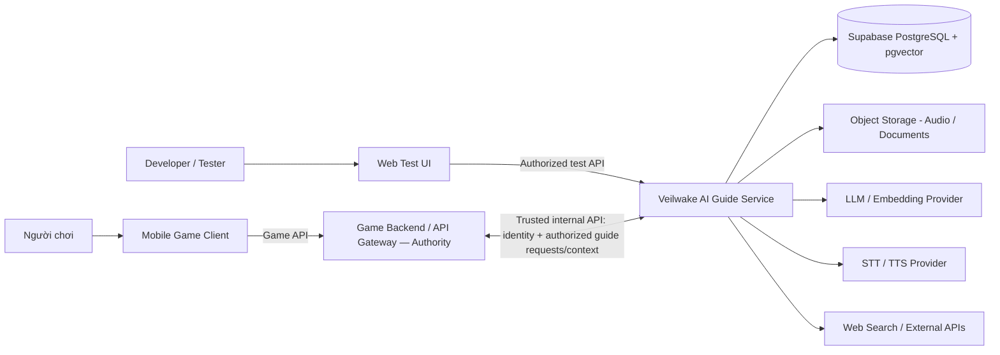

**Trust boundaries:** Mobile/Web là client không tin cậy. Game Backend/API Gateway xác thực player/session và chuyển identity/context tối thiểu đã cấp quyền tới AI Guide Service. AI Guide Service giữ provider keys, kiểm tra service token/identity claims, quyền đối tượng, nguồn dữ liệu và tool permissions. Game Backend là nguồn xác thực trạng thái người chơi. External Web là nguồn **không tin cậy theo mặc định**.

### 3.2. Module/container view (C4 — Level 2)

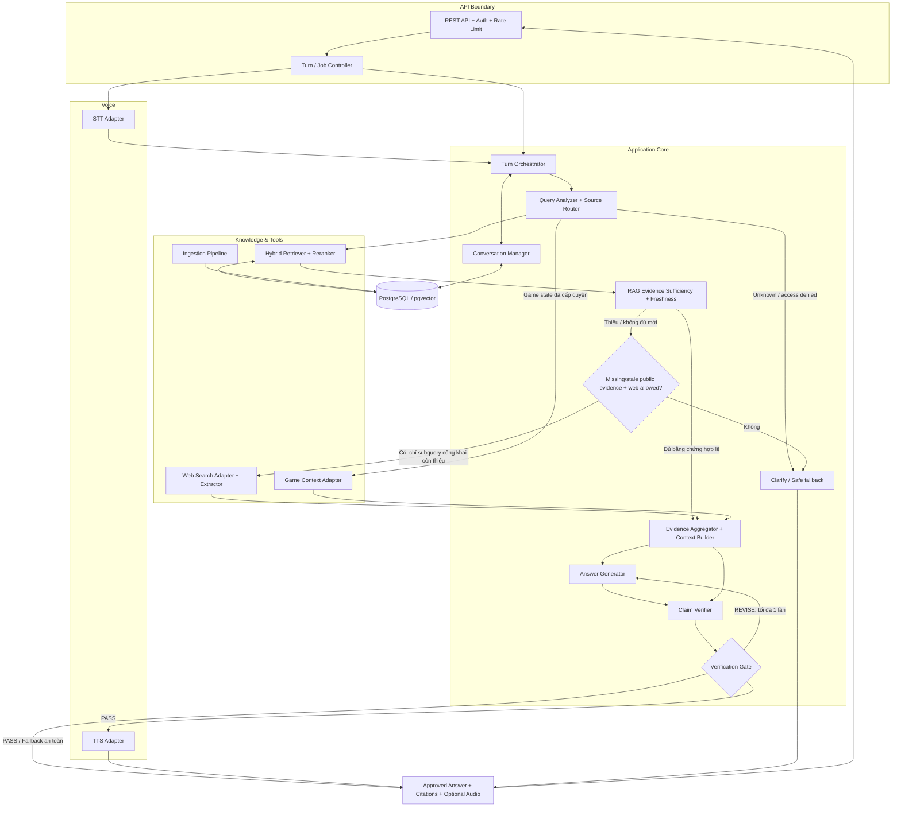

> **Lưu ý:** Sơ đồ logic rút gọn; nhánh `DIRECT` và các lỗi/timeout cũng đi qua chính sách của Orchestrator; fallback được định nghĩa sẵn hoặc xử lý an toàn, không phải draft chưa kiểm chứng. Bằng chứng web vẫn phải qua kiểm tra nguồn/freshness trước Generator. Không có cạnh gọi web trực tiếp từ Router hoặc truy xuất RAG và web song song cho cùng subquestion.

### 3.3. Danh mục module backend

| Mã | Module | Input → Output | Độ ưu tiên MVP |
|---|---|---|---|
| B01 | API & Auth | HTTP/auth → lệnh hợp lệ | P0 |
| B02 | Turn Orchestrator | Turn request → turn state/result | P0 |
| B03 | Conversation Manager | Session/turn → history/context | P0 |
| B04 | Knowledge Source Manager | File/URL → approved source | P0 |
| B05 | Ingestion & Embedding | Approved source → chunks/vectors | P0 |
| B06 | Knowledge Storage | Chunks/metadata → searchable data | P0 |
| B07 | Query Analyzer & Source Router | Query/context → domain, quyền và RAG-first retrieval plan + web eligibility | P0 |
| B08 | Internal Retrieval | Query + filters → candidates | P0 |
| B09 | Reranking & Context Builder | Candidates → evidence package | P0 |
| B10 | Web Search | Phần evidence công khai còn thiếu/quá cũ + backend cho phép → external evidence | P0, chỉ gọi có điều kiện |
| B11 | Game Context Provider | Trusted identity → game state/hints | P0 interface, P1 live integration |
| B12 | Answer Generator | Query + evidence → draft | P0 |
| B13 | LLM Verifier | Draft + evidence → claim report | P0 |
| B14 | Verification Gate | Report → PASS/REVISE/REJECT | P0 |
| B15 | STT Adapter | Audio → transcript | P0 |
| B16 | TTS Adapter | Approved answer → audio | P0 |
| B17 | Telemetry, Evals & Audit | Trace/events → metrics | P0 tối thiểu |
| B18 | Worker & Storage | Async job, file lifecycle | P0 tối thiểu |

*P0: bắt buộc cho MVP voice-first: nhận tiếng nói, trả lời bằng text đã kiểm chứng và phát lại bằng voice khi provider sẵn sàng. Nếu TTS lỗi, kết quả an toàn là `COMPLETED_TEXT_ONLY`; không phát draft. Dev Voice API ở Phase 0.5 dùng một tập module tối thiểu để test app với `NOT_RUN`, không được tính là đã hoàn thành các module verification/RAG P0.*

---

## 4. Luồng xử lý từng lượt hội thoại

### 4.1. Sequence — câu hỏi bằng văn bản

```mermaid
sequenceDiagram
    autonumber
    actor User as Người chơi
    participant C as Mobile/Web Client
    participant API as API + Auth
    participant O as Orchestrator
    participant R as Router
    participant K as Retrieval / Web / Game
    participant G as Generator
    participant V as Verifier
    participant P as Verification Gate
    participant DB as DB
    User->>C: Nhập câu hỏi
    C->>API: POST /v1/conversations/{id}/turns
    API->>API: Verify JWT + quyền + idempotency
    API->>DB: Persist turn PENDING
    API-->>C: 202 Accepted + turn_id
    API->>O: Start job
    O->>R: Query + lịch sử + game context
    R->>K: Authorized RAG-first plan; Game Backend nếu game_state
    K-->>O: Initial evidence + source metadata
    O->>O: Check sufficiency, freshness và web eligibility
    opt RAG thiếu/quá cũ và subquery công khai được phép dùng web
        O->>K: Web fallback cho phần còn thiếu, trong budget
        K-->>O: External evidence + nguồn + thời điểm
        O->>O: Validate nguồn và merge evidence theo domain
    end
    alt Evidence vẫn không đủ hoặc không được phép trả lời
        O->>O: Safe fallback / clarification; không tạo draft
    else Evidence đủ và đúng phạm vi
        O->>G: Query + authorized evidence
        G-->>O: Draft answer
        O->>V: Draft + evidence + policies
        V-->>P: Claim-level verification report
        alt PASS
            P-->>O: Approved text + citation IDs
        else REVISE lần đầu
            P-->>O: Issues
            O->>G: Revise theo evidence
            G-->>O: Revised draft
            O->>V: Verify again
            V-->>P: Report
            P-->>O: PASS hoặc REJECT
        else REJECT / ERROR
            P-->>O: Safe fallback
        end
    end
    O->>DB: Persist final response + audit
    C->>API: GET /v1/turns/{turn_id}
    API-->>C: Completed answer + citations / fallback
    C-->>User: Hiển thị kết quả
```

**Quy tắc:** kết quả `draft` và verification details chỉ có ở API nội bộ/admin; public endpoint không trả draft. Giá trị `verification_status=PASS` chỉ được tạo từ server-side gate. Sequence này mô tả nhánh câu hỏi factual; `DIRECT` dùng template, còn domain chưa rõ thì hỏi lại trước retrieval/web. Với `game_lore` hoặc `game_state`, `web_search_allowed=false` dù evidence rỗng; không dùng web để vượt quyền hoặc spoiler.

### 4.2. Sequence — câu hỏi bằng giọng nói (không realtime)

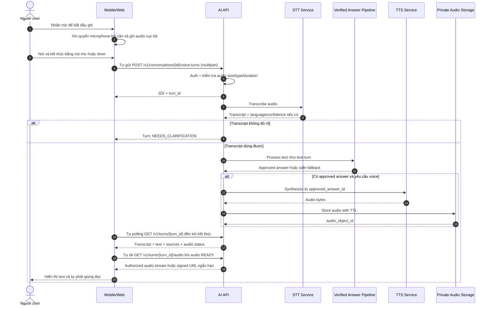

**Quyết định thiết kế cho pipeline verified:** tạo âm thanh **chỉ sau khi final answer được duyệt**. Với trường hợp fallback, dùng thông báo đã định nghĩa trước và có thể tổng hợp TTS từ thông báo đó; không được đọc bản draft bị từ chối. Sơ đồ trên mô tả contract production; request từ Mobile được chuyển qua Game Backend/API Gateway theo mục 11.1. Dev Voice API nội bộ dùng endpoint riêng ở mục 11.7 và không báo đã verification.

### 4.3. State machine cho một turn

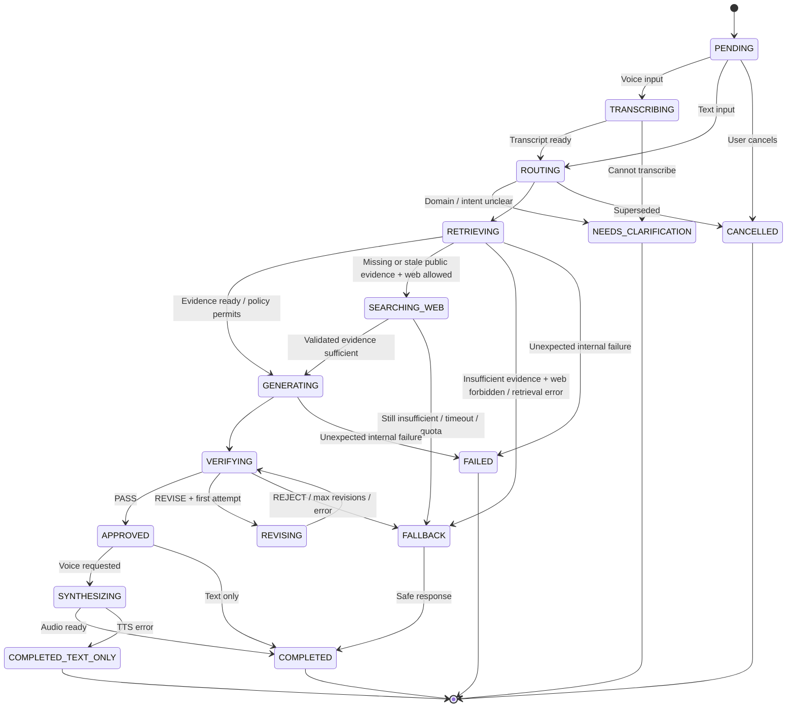

Không phát hành audio nếu turn đã bị hủy hoặc thay thế bởi phiên bản yêu cầu mới (`turn_revision`/`request_generation`). Cần timeout tổng và timeout từng provider; jobs tồn tại bền vững để không mất khi process khởi động lại.

---

## 5. Knowledge Management & Ingestion

### 5.1. Phân miền dữ liệu (knowledge domains)

| Domain | Nội dung | Nguồn có thẩm quyền | Điều kiện truy cập |
|---|---|---|---|
| `real_world` | Lịch sử, kiến trúc, văn hóa, ẩm thực | Website/tài liệu được duyệt; web khi cần | Theo phạm vi địa điểm và chất lượng nguồn |
| `game_lore` | Ký Giới, Dư Ức, Điệp Ức, các chương truyện | Chỉ canonical lore/docs đã duyệt; không web fallback | `story_access_level`, `quest_gate`, `npc_visibility` |
| `game_state` | Người chơi, huy hiệu, nhiệm vụ, manh mối đã mở | **Game Backend**, không phải vector DB hoặc web | Theo JWT và server-side ownership |
| `dynamic_web` | Giờ mở cửa, giá vé, lịch sự kiện, cập nhật | RAG nếu bằng chứng đủ mới; web/địa điểm API chỉ bổ sung khi thiếu/quá cũ | Freshness theo yêu cầu câu hỏi + source attribution |

**Nguyên tắc:** Không tự động trộn `game_lore` vào câu trả lời lịch sử thật; không sử dụng RAG để suy ra quyền nhận thưởng hoặc hoàn thành nhiệm vụ. `dynamic_web` là miền thông tin thay đổi theo thời gian, không phải chỉ thị bắt buộc gọi web. Website công khai có nhắc đến Saigon: Veilwake không trở thành nguồn canon và không thay thế được lore nội bộ bị thiếu hoặc bị chặn quyền.

### 5.2. Ingestion pipeline

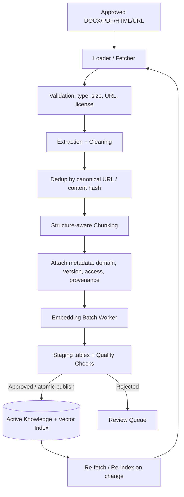

#### Metadata tối thiểu

- `source_id`, `document_id`, `chunk_id`, `canonical_url`, `title`, `source_type`.
- `knowledge_domain`, `language`, `region_id`, `location_id`, `tags`.
- `document_version`, `content_hash`, `ingested_at`, `source_published_at`, `last_reviewed_at`.
- `approval_status`, `active_version`, `visibility`, `story_access_level`, `quest_gate`.
- `embedding_model`, `embedding_version`, `chunker_version`, `text_span` (vị trí trích dẫn).

**Ingestion policy:** bản ghi mới phải qua staging; chỉ những phiên bản *approved* được đưa vào retrieval. Khi cập nhật: lập chỉ mục phiên bản mới, kiểm tra, chuyển con trỏ `active_version` rồi gỡ phiên bản cũ; tránh khoảng trống tri thức. Nội dung hư cấu không được dùng để xác nhận thông tin ngoài đời.

### 5.3. Chunking & indexing

- Bắt đầu bằng **heading/paragraph-aware chunking**, giữ các thực thể và chú thích cạnh nhau; không chẻ một định nghĩa lore thành nhiều đoạn mất ngữ cảnh.
- Kích thước/overlap là **hyperparameters để đo**, không chốt cứng ở giai đoạn proposal (thử ví dụ ~350–650 tokens và overlap ~50–100 tokens tùy tài liệu).
- Dùng một embedding model thống nhất cho index và query; thay model yêu cầu re-embed/re-index tương ứng.
- PostgreSQL full-text search tiếng Việt cần benchmark riêng về dấu, từ ghép, tên riêng và cách tách từ; **không sao chép cấu hình `english` từ ví dụ tài liệu vào dữ liệu tiếng Việt**. Có thể thử `simple`, text normalization, n-gram/trigram hoặc một tokenizer/search engine phù hợp.
- pgvector: bắt đầu với exact search nếu tập dữ liệu nhỏ; khảo sát HNSW khi scale/latency đòi hỏi, đo recall và tài nguyên.

---

## 6. Query Analysis, Source Router và Web Search

### 6.1. Routing policy — RAG-first, Web fallback có điều kiện

**Quyết định đã chốt ngày 28/10/2026:** RAG là nguồn chính cho câu hỏi kiến thức; Web Search chỉ là nguồn bổ sung có kiểm soát. **Không tìm thấy trong RAG không đồng nghĩa với được phép tìm web.**

Thứ tự xử lý bắt buộc:

1. Xác định domain và phạm vi quyền của câu hỏi/subquestion trước khi truy xuất. `DIRECT` dùng template; `game_state` đọc Game Backend; nếu chưa phân biệt được lore độc quyền với thông tin ngoài đời thì hỏi lại, mặc định không gọi web.
2. Với câu hỏi kiến thức, truy xuất Internal RAG sau khi lọc domain, source/version đã duyệt và quyền/spoiler. Không nới filter để tìm cho bằng được tài liệu.
3. Đánh giá bằng chứng RAG về mức liên quan, độ bao phủ câu hỏi, nguồn có thẩm quyền, mâu thuẫn và freshness. Có một chunk hoặc điểm similarity cao chưa đủ chứng minh câu hỏi đã được trả lời. Ngưỡng retrieval/freshness phải cấu hình và đánh giá trên test set, không dùng một ngưỡng similarity tùy ý cho mọi domain.
4. Nếu đủ bằng chứng hợp lệ và đủ mới theo yêu cầu câu hỏi: dùng RAG, **không gọi web**.
5. Chỉ mở nhánh web khi RAG đã được kiểm tra và bằng chứng thiếu hoặc quá cũ **đồng thời** domain thuộc `real_world`/`dynamic_web`, quyền truy cập hợp lệ và policy/budget cho phép. Chỉ tìm phần thông tin công khai còn thiếu.
6. Nếu không được phép tìm web hoặc sau web vẫn chưa đủ bằng chứng: hỏi lại, trả phần đã xác minh có giới hạn hoặc dùng fallback đã duyệt. Không yêu cầu Generator tự bù thông tin từ trí nhớ mô hình.

| Loại câu hỏi | RAG đủ bằng chứng phù hợp | RAG thiếu bằng chứng hoặc không đáp ứng freshness | Mode / ràng buộc |
|---|---|---|---|
| Lore/canon độc quyền: “Điệp Ức là gì?” | Chỉ trả lời từ canonical lore được phép xem | Thừa nhận chưa có thông tin xác minh hoặc hỏi lại; **không web fallback** | `INTERNAL`; `web_search_allowed=false` |
| Nội dung bị khóa: “Ai là phản diện cuối mùa?” | Chỉ dùng bằng chứng trong quyền thực tế; không tiết lộ nội dung bị khóa | Trả phản hồi theo spoiler policy; **không tìm web hoặc cache ngoài quyền** | `GAME_LORE_GATED`; `web_search_allowed=false` |
| Lịch sử/kiến trúc công khai: “Bưu điện có nét kiến trúc nào?” | Dùng RAG, không gọi web | Web fallback có trích nguồn nếu policy cho phép | `INTERNAL` → `WEB`/`HYBRID` chỉ sau eligibility gate |
| Thông tin thay đổi: “Hôm nay có mở cửa?” | Dùng RAG nếu có bằng chứng đủ mới cho thời điểm hỏi | Web/Places API để bổ sung; nêu thời điểm kiểm tra, không khẳng định nếu chưa xác minh | `INTERNAL` → `WEB`/`EXTERNAL_API` có điều kiện |
| Câu nhiều phần: “Kể lịch sử và giờ mở cửa hôm nay” | Từng phần đủ bằng chứng thì dùng RAG | Chỉ tìm web cho subquestion công khai còn thiếu/quá cũ | `HYBRID` mô tả evidence kết hợp, không phải gọi hai nguồn mặc định |
| Trạng thái: “Tôi có nhận được Mảnh Ký Ức chưa?” | Không dùng RAG làm thẩm quyền state | Đọc Game Backend đã cấp quyền; backend không khả dụng thì nói chưa kiểm tra được | `GAME_STATE`; không RAG/web thay thế |
| “Xin chào” | Không cần retrieval | Template/policy answer | `DIRECT`; không web/RAG |
| Câu hỏi nhập nhằng giữa lore và đời thực | Chưa xác định đủ domain thì chưa retrieval | Hỏi rõ ý người dùng trước; không thử web để đoán domain | `NEEDS_CLARIFICATION`; web mặc định bị tắt |

Router có thể dùng rule-based classifier trước, LLM planner hỗ trợ các trường hợp nhập nhằng. **LLM chỉ đề xuất kế hoạch; policy engine của backend kiểm tra domain, quyền, sufficiency/freshness và giới hạn tool trước khi thực thi.** Người dùng yêu cầu “tìm trên mạng thay đi” hoặc nội dung retrieved yêu cầu gọi tool không được ghi đè policy của domain.

#### 6.1.1. Các trường hợp không được mở web fallback

- `game_lore`, canon, đáp án bí ẩn và nội dung thiết kế độc quyền: nguồn xác nhận là tài liệu nội bộ đã duyệt. Web công khai, diễn đàn hoặc wiki không thay thế thẩm quyền canon.
- Nội dung bị loại bởi `story_access_level`, quest gate, NPC visibility hoặc object authorization: không dùng web, cache hay truy vấn lại với filter rộng hơn để vượt chặn. Phản hồi không tiết lộ chi tiết nội dung bị khóa.
- `game_state`: chỉ Game Backend có thẩm quyền; không suy ra từ RAG hoặc web.
- Domain/intent chưa rõ: hỏi lại, không mặc định biến câu hỏi thành `real_world` chỉ vì RAG rỗng.
- Lỗi hạ tầng retrieval/timeout: xử lý lỗi/retry có giới hạn hoặc fallback an toàn. Lỗi retrieval không phải bằng chứng nội dung không tồn tại và không tự cấp quyền gọi web.

Kết quả web chỉ là external evidence của domain công khai. Không tự động ingest/publish thành canonical lore. Với câu hỏi pha trộn lore và đời thực, tách subquestion trước; không gửi cả câu hỏi chứa lore độc quyền hoặc game context vào search provider.

#### 6.1.2. Quyết định routing có thể kiểm thử

Backend ghi quyết định tối thiểu cho từng subquestion: `knowledge_domain`, `allowed_sources`, `rag_evidence_status`, `web_search_allowed`, `fallback_reason` và `web_search_used`. Đây là metadata policy nội bộ, không chứa key/JWT và không cần công khai chi tiết quyền bị chặn cho client.

Các reason code đề xuất để phân biệt hành vi:

| `rag_evidence_status` / lý do | Hành động |
|---|---|
| `SUFFICIENT` | Dùng evidence hiện có; web không được gọi |
| `INSUFFICIENT` / `STALE` | Xét eligibility theo domain/quyền/budget; không tự động gọi web |
| `ACCESS_RESTRICTED` | Giữ nguyên quyền; không web hoặc nới retrieval filter |
| `RETRIEVAL_ERROR` | Nhánh xử lý lỗi; không coi là RAG miss để gọi web |
| `UNKNOWN_DOMAIN` | Hỏi lại; chưa được gọi web |

Chi tiết schema/ngưỡng là công việc triển khai; **invariant đã chốt** là không có đường từ RAG miss tới Web Search mà bỏ qua backend eligibility gate. Cache web nếu được dùng cũng phải nằm sau gate, đúng domain và còn TTL/freshness.

### 6.2. Sơ đồ Router

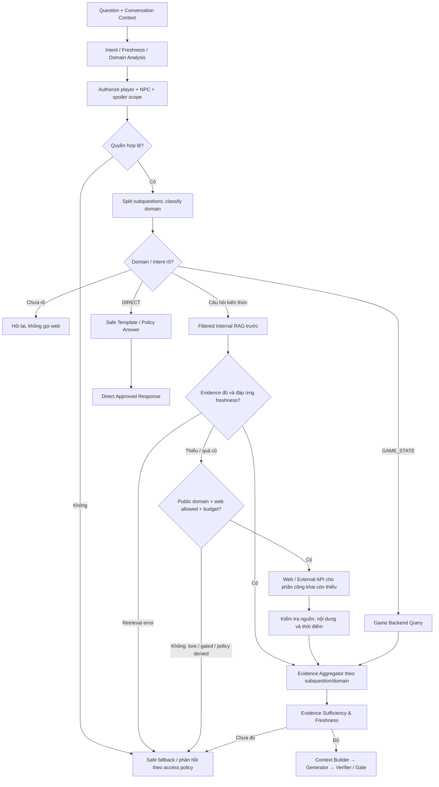

### 6.3. Web Search component (B10)

| Submodule | Đầu vào → đầu ra | Kiểm soát |
|---|---|---|
| Web Eligibility Gate | RAG sufficiency/freshness + domain/quyền → allow/deny | Chỉ mở sau RAG thiếu/quá cũ; chặn lore độc quyền, game state, access bypass và retrieval error |
| Search Query Planner | Chỉ subquestion công khai còn thiếu đã được gate cho phép → search queries | Giới hạn số query, thời gian, vùng; không gửi lore riêng/JWT/raw game state |
| Search Provider Adapter | Query → search results | Tavily/Brave/API khác qua cùng interface |
| Content Extractor | URL/result → đoạn nội dung | Chặn SSRF, giới hạn size/time, xử lý HTML |
| Source Validator | Page → source metadata | Publisher, date, domain, contradictions |
| Evidence Normalizer | Results → `EvidenceItem[]` | Stable ID, URL, span, provenance |
| Cache Manager | Authorized public subquery → cached results | Kiểm tra eligibility trước cache; TTL/freshness theo chủ đề, không cache vô hạn |
| Failure Handler | Timeout/rate limit → fallback | Không tự khẳng định dữ liệu “hiện tại” |

**Provider strategy:** tạo interface `search(query, freshness, locale, max_results)`; bắt đầu thử **một provider** (Tavily hoặc Brave). Đo coverage địa danh Việt Nam, latency, metadata ngày tháng, chi phí và điều kiện sử dụng; không chốt nhà cung cấp chỉ dựa trên mô tả marketing.

**Quan trọng:** Search API trả **kết quả tìm kiếm**, không phải xác nhận địa điểm đang mở hoặc giá vé chính xác. Với giờ mở cửa/địa điểm, ưu tiên hệ thống địa điểm chuyên biệt và nguồn chính thức khi được tích hợp; nêu rõ trạng thái chưa xác minh nếu dữ liệu mâu thuẫn.

Khi RAG đủ bằng chứng hoặc câu hỏi thuộc lore độc quyền, số lời gọi web phải bằng **0**. Kết quả web không làm thay đổi `allowed_sources`, quyền spoiler hoặc authority của domain.

### 6.4. Evidence Schema (hợp nhất nguồn)

```json
{
  "evidence_id": "ev_01",
  "source_kind": "internal_document",
  "knowledge_domain": "real_world",
  "title": "Example title",
  "url": "https://example.org/article",
  "document_version": "1.0",
  "text": "Trích đoạn nội dung đã lấy...",
  "span": {"start": 100, "end": 164},
  "retrieved_at": "2026-10-27T13:00:00+07:00",
  "published_at": null,
  "trust_tier": "reviewed",
  "visibility_scope": "public",
  "relevance_score": null
}
```

`trust_tier` chỉ là metadata về nguồn/quy trình duyệt; **không được coi là xác suất đúng**.

### 6.5. Reranking và hợp nhất evidence sau fallback có điều kiện

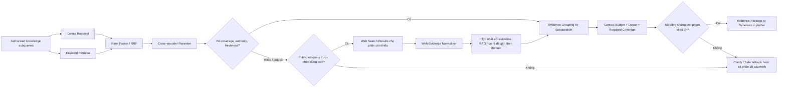

`HYBRID` ở đây mô tả **kết quả hợp nhất evidence** sau khi web fallback được phép chạy, không có nghĩa gọi Internal và Web song song cho cùng subquestion. Retrieval nội bộ vẫn có thể kết hợp dense + keyword bằng RRF.

Đề xuất thử Top **20** candidates nội bộ → Top **5–8** sau reranking, **không** để Top K chung loại hết nguồn cập nhật hoặc các subquestion quan trọng. Với query hỗn hợp, giữ quota evidence riêng cho từng phần; chỉ bổ sung web cho phần công khai còn thiếu/quá cũ. Evidence nội bộ quá cũ không được dùng để xác nhận một claim “hiện tại”. Context Builder kiểm tra đủ coverage sau khi hợp nhất, tách game canon khỏi đời thực và trả lời giới hạn nếu còn phần chưa được xác minh. Đánh giá `Recall@K`, `nDCG@K`, citation quality và end-to-end answer support trước khi chỉnh K.

### 6.6. Acceptance cases cho policy RAG-first

| Tình huống kiểm thử | Hành vi bắt buộc | Web call |
|---|---|---|
| Lore có đủ evidence được phép xem | Dùng canonical RAG; Generator/Verifier nhận đúng nguồn | `0` |
| Lore không có trong corpus được duyệt | Thừa nhận chưa có thông tin xác minh; không tự bịa canon | `0` |
| Lore bị lọc vì spoiler/quyền | Giữ nguyên filter, không tìm vòng qua web/cache | `0` |
| Thông tin ngoài đời có RAG đủ, hợp lệ và đủ mới | Dùng RAG hiện có | `0` |
| Thông tin ngoài đời thiếu evidence, domain/quyền hợp lệ | Web fallback cho subquestion còn thiếu trong budget; trích nguồn | Có thể gọi sau gate |
| Giờ mở cửa có RAG cũ so với thời điểm hỏi | Đánh giá freshness rồi mới mở web/API; không dùng bản cũ để khẳng định hiện tại | Có thể gọi sau gate |
| Câu hỏi gồm lore độc quyền và thông tin công khai còn thiếu | Tách câu hỏi; chỉ gửi phần công khai ra web, lore vẫn chỉ dùng RAG | Chỉ phần công khai |
| Domain nhập nhằng | Hỏi lại, không mặc định tìm web | `0` |
| Game Backend không khả dụng khi hỏi state | Nói chưa kiểm tra được; không dùng RAG/web thay backend | `0` |
| Retrieval timeout/lỗi | Retry có giới hạn hoặc fallback lỗi; không coi là thiếu tri thức | `0` |
| Web lỗi, hết quota hoặc evidence vẫn thiếu/mâu thuẫn | Fallback/hỏi lại hoặc trả phần đã xác minh; không release draft thiếu nguồn | Không vượt budget |

Test Router/Orchestrator phải dùng mock/spy để assert số lần gọi search và **nội dung subquery được phép gửi**, không chỉ kiểm tra answer cuối. Trace ghi được lý do mở/không mở web để đối chiếu policy. TTS vẫn chỉ nhận text đã qua Verification Gate như các nguồn khác.

---

## 7. Generator, Verifier và Verification Gate

### 7.0. Provider Generator/Verifier cho MVP voice-first

Generator/Verifier của MVP dùng **Groq Free Tier** qua một `LLM Provider Adapter`. Đây là lựa chọn để thử nghiệm/đánh giá, **không** là cam kết SLA hay quota production: giới hạn free tier, model khả dụng và điều khoản provider có thể thay đổi. Backend phải đọc quota thực tế từ provider, giới hạn lượt gọi/token, retry có backoff khi nhận `429`, và trả fallback an toàn khi hết quota hoặc provider lỗi.

- **Generator và Verifier** là hai lời gọi độc lập, dùng prompt/context/schema riêng. Ưu tiên benchmark Generator và Verifier bằng các model Groq đang hỗ trợ tool calling/structured output; model ID nằm trong config theo môi trường.
- Verifier bắt buộc yêu cầu JSON Schema nghiêm ngặt khi model hỗ trợ; nếu provider/model không đáp ứng schema hoặc trả lỗi thì turn không được `PASS`.
- Không gửi `player_id`, JWT, raw game state, dữ liệu định danh không cần thiết hoặc lore ngoài phạm vi evidence đã được cấp quyền. Chỉ gửi câu hỏi đã chuẩn hóa, context/evidence đã lọc và policy tối thiểu cần thiết.
- Không cấp cho LLM quyền trực tiếp gọi Game Backend, database hoặc công cụ web. Source Router/Policy Engine của backend quyết định và thực thi tool access.
- Không dùng API key miễn phí ở mobile/web client; key chỉ được giữ trong secret store của backend.

Với `DIRECT` template, evidence không đủ hoặc quota/provider lỗi, backend trả câu phản hồi định sẵn/đã duyệt; không phát bản nháp chưa kiểm chứng.

### 7.1. Contract Generator

**Input:** `normalized_question`, `authorized_conversation_context`, `npc_persona`, `answer_policy`, `evidence_package`.  
**Output:** `draft_answer` + `claim_candidates`/`citations` ở dạng có cấu trúc.

**Yêu cầu:** không tự đặt lịch/giá/câu chuyện, không vượt spoiler scope, tách thực tế với hư cấu, không coi web text là system instruction. Bỏ nội dung thiếu bằng chứng khi câu hỏi factual. Với văn phong nhập vai NPC, lời thoại có thể sáng tạo nhưng không tự tạo **sự kiện canon** hoặc kết quả nhiệm vụ.

### 7.2. Contract Verifier

**Input độc lập:** câu hỏi gốc + draft + **evidence gốc** + allowed scopes/rules; không chỉ nhận bản tóm tắt do Generator tự viết.  
**Output:** structured report gồm claim-level `SUPPORTED` / `UNSUPPORTED` / `CONTRADICTED` / `INSUFFICIENT_EVIDENCE`, evidence IDs và `recommended_action`.

```json
{
  "schema_version": "1.0",
  "decision": "REVISE",
  "claims": [
    {
      "claim_id": "c1",
      "text": "Một khẳng định từ bản nháp",
      "status": "SUPPORTED",
      "supporting_evidence_ids": ["ev_01"]
    },
    {
      "claim_id": "c2",
      "text": "Một khẳng định khác",
      "status": "UNSUPPORTED",
      "supporting_evidence_ids": []
    }
  ],
  "issues": ["c2 thiếu bằng chứng"],
  "recommended_action": "REMOVE_UNSUPPORTED_CLAIM"
}
```

### 7.3. Deterministic Verification Gate

Verifier **không tự có quyền xuất bản**. Backend kiểm tra schema, citation IDs, claim statuses, access policy, spoiler policy, claim-to-evidence mapping và các ràng buộc freshness. Nếu Verifier trả `PASS` nhưng có claim factual `UNSUPPORTED`, gate vẫn **REJECT/REVISE**.

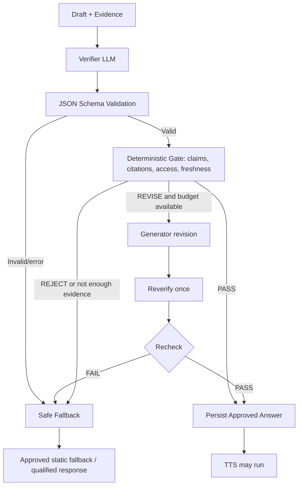

**Chính sách:**

- `PASS`: các khẳng định factual quan trọng có evidence hợp lệ; quyền truy cập và freshness đạt.
- `REVISE`: phát hiện claim có thể bỏ/sửa dựa trên evidence; tối đa **1 vòng sửa** ở MVP.
- `REJECT`: nguồn không đủ, mâu thuẫn nghiêm trọng, nguy cơ spoiler, lỗi schema, timeout và không sửa được.
- **Fallback**: thông báo trung thực “Mình chưa xác minh được thông tin này...” hoặc hỏi lại; đây là text **định sẵn được phép phát**, không phải bản nháp.
- **Không lưu điểm Verifier như ‘xác suất sự thật’.** Theo dõi false accept/false reject qua bộ test được người kiểm duyệt gán nhãn.
- **TTS chỉ nhận một `approved_answer_id` tồn tại**, không nhận arbitrary draft từ client.

### 7.4. Hai chế độ nội dung

1. `FACTUAL_GROUNDED`: lịch sử, giá, giờ mở cửa, quy định, hướng dẫn; mọi khẳng định cần bằng chứng tương ứng.
2. `ROLEPLAY_GROUNDED`: NPC có persona/giọng kể nhưng sự kiện canon, kết quả vụ án và thông tin đời thực vẫn phải hợp lệ. Có thể có lời dẫn/hội thoại hư cấu rõ ngữ cảnh mà không biến thành tuyên bố lịch sử thật.

---

## 8. Game Context và chống spoiler

### 8.1. Interface giữa AI Guide Service và Game Backend

| Read API nội bộ (đề xuất) | Mục đích | Nguồn kiểm soát |
|---|---|---|
| `get_player_context(player_id)` | Vùng/mốc nhiệm vụ, trạng thái truy cập | Server-side JWT/ownership |
| `get_npc_context(npc_id, player_id)` | Persona, NPC knowledge scope | Canonical NPC configuration |
| `get_location_context(location_id)` | Địa điểm game và kiến thức khả dụng | Game data |
| `get_unlocked_hints(player_id, quest_id)` | Gợi ý đúng tiến trình | Game state + quest rules |
| `get_quest_status(player_id, quest_id)` | Trạng thái nhiệm vụ | Game Backend authoritative |

AI Guide Service **không** gọi API ghi nhận hoàn thành, cấp vật phẩm hoặc thay đổi đáp án theo lời tự khẳng định của LLM. Nếu tương lai cần write actions, phải có transaction/authorization/confirmation riêng với Game Backend.

### 8.2. Spoiler guard là **pre-retrieval filter**

Ví dụ nhân vật **Người Giữ Im Lặng** có vai trò quan trọng trong phần cuối mùa đầu. Nếu người chơi chưa mở nội dung tương ứng, bộ lọc `story_access_level` phải loại bỏ các tài liệu chứa bí mật khỏi **tập ứng viên tìm kiếm trước khi gửi sang LLM**, không chỉ nhắc LLM “đừng tiết lộ”.

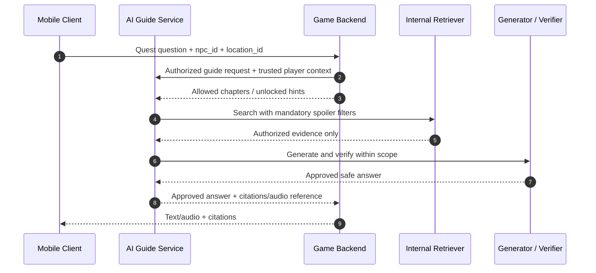

Nguyên tắc game v1.0 cần duy trì: đáp án vụ án được thiết kế trước; AI gợi ý, giải thích, nhập vai — không tự đổi kết luận. Thông tin địa điểm ngoài đời và hư cấu phải có nhãn/nguồn phân biệt.

---

## 9. Conversation Management

### 9.1. Memory layers

| Lớp | Nội dung | Nơi lưu | Quy tắc |
|---|---|---|---|
| Current turn | Câu hỏi, nguồn, trạng thái job | PostgreSQL | Idempotent + trace |
| Recent messages | Các lượt gần đây | PostgreSQL | Có giới hạn context |
| Running summary | Tóm tắt hội thoại dài | PostgreSQL | Được tạo/version hóa, không thay evidence |
| NPC context | Persona, nhiệm vụ, quyền tiết lộ | Game Backend + config | Refresh theo phiên |
| User preferences | Ngôn ngữ, bật/tắt audio | PostgreSQL | Có sự đồng ý nếu cần |

**Quy tắc:** memory giúp giải quyết đại từ và mạch hội thoại, **không** được thay thế bằng chứng factual. Có thể xoá/làm mới session. Game state đọc mới khi các quyền/quest có thể thay đổi, không dựa vào summary cũ.

### 9.2. Idempotency và concurrency

- `Idempotency-Key` trên POST tạo turn: request retry không tạo nhiều câu trả lời/chi phí lặp.
- Mỗi session có `latest_turn_revision` để hủy kết quả cũ không còn đúng ngữ cảnh.
- Có chính sách tối đa **một active turn/session** cho MVP hoặc hàng đợi turn rõ ràng.
- Async worker ghi checkpoint: `ROUTING`, `RETRIEVING`, `GENERATING`, `VERIFYING`, `TTS`.
- Nếu request hết hạn ở client, job có thể tiếp tục trên server và client tra cứu lại bằng `turn_id`.

---

## 10. Voice Processing (STT/TTS, không realtime)

### 10.1. UX app đã chốt — nhấn mic, tự gửi, tự phát

**Hành vi người dùng:** nhấn nút microphone để ghi, nói một câu, kết thúc ghi bằng thao tác nút mic hoặc khi chạm giới hạn thời gian. Sau đó app **tự gửi bản ghi, theo dõi xử lý, hiển thị câu trả lời text và tự phát audio phản hồi**. Không yêu cầu người dùng chọn file, tìm bản ghi hoặc bấm nút “Upload/Gửi audio” riêng.

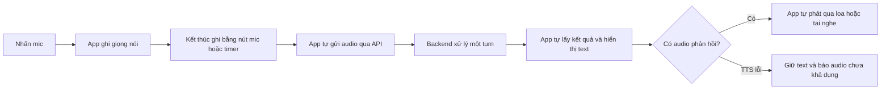

- Có thể hiện thực nút mic theo kiểu **nhấn giữ rồi thả** hoặc **nhấn bắt đầu, nhấn lần nữa để dừng**; đây là lựa chọn interaction của app, không thay đổi API. Không bắt buộc triển khai cả hai kiểu ngay trong milestone đầu.
- “Không upload thủ công” là quyết định **UX**. Audio vẫn phải được app truyền qua mạng tới backend; baseline là ghi xong rồi tự gửi file bằng multipart HTTP.
- Chưa streaming audio trong lúc đang nói, chưa WebRTC, chưa VAD tự xác định kết thúc câu và chưa hỗ trợ nói chen để ngắt audio phản hồi. Không diễn giải quyết định này thành realtime voice.
- App sở hữu xin quyền microphone, start/stop recorder, hiển thị trạng thái đang ghi/đang xử lý/đang phát và playback. Server không dùng microphone/loa của máy chạy backend.
- Thời lượng test ban đầu tối đa 30 giây/lượt; app và API cùng thực thi giới hạn. Định dạng recorder thực tế (WAV hay AAC/M4A...) phải chốt theo app trước khi implement API. Server kiểm tra bytes/codec/thời lượng và normalize khi cần, không chỉ tin MIME hoặc đổi đuôi file.
- Nếu người dùng từ chối quyền mic, audio rỗng/quá ngắn, upload lỗi hoặc provider lỗi: app hiển thị lỗi phù hợp và cho thử lại có kiểm soát; không tự tạo nhiều turn hoặc lặp request tốn quota vô hạn.
- App chỉ gửi một turn cho một lần ghi. Retry truyền mạng cần giữ cùng idempotency key; đang xử lý phải có trạng thái rõ ràng để tránh gửi trùng do bấm mic liên tiếp.

### 10.2. Pipeline voice đã kiểm chứng cho MVP

**STT adapter** nhận audio từ API sau kiểm tra MIME, thời lượng, kích thước, quyền truy cập. Cần normalize format để tương thích nhà cung cấp, xác định ngôn ngữ tiếng Việt, xử lý tên riêng (Điệp Ức, Ký Giới, Bưu điện Trung tâm Sài Gòn) và trả transcript để lưu cùng turn.

**TTS nghiệp vụ của pipeline verified** chỉ nhận `approved_answer_id`; có thể hỗ trợ `voice_id`, `locale`, `speaking_style` và `speed` nhưng **không** được tự sửa nội dung factual. Backend tra approved text rồi mới gọi provider adapter cấp thấp; adapter cấp thấp nhận text không phải một public API cho arbitrary draft từ client. Chia đoạn văn bản nếu provider có giới hạn ký tự, ghép audio/manifest theo đúng thứ tự. Audio có TTL, quyền truy cập và signed URL thời hạn ngắn.

**Trường hợp bất thường:** STT nhận sai tên riêng → hỏi xác nhận (khi ambiguity ảnh hưởng câu trả lời). TTS thất bại → trả `COMPLETED_TEXT_ONLY` (không huỷ nội dung đã duyệt). Không giữ file ghi âm quá thời hạn cần thiết cho vận hành nếu không có lý do và sự đồng ý phù hợp.

### 10.3. Dev Voice API — milestone test app trước RAG

**Mục tiêu:** đưa pipeline Terminal Voice POC đã hoạt động lên API để kiểm chứng recorder, mạng, polling và playback của app. Tái sử dụng `GeminiSttProvider`, `GroqGeneratorProvider`, `GeminiTtsProvider` và logic orchestration phù hợp; không đưa code nhập phím, `sounddevice` hoặc cleanup ngay sau playback của terminal vào request handler.

Luồng demo: **app ghi xong → tự gửi → Gemini STT → Groq Generator tổng quát → Gemini TTS → app nhận text và tự phát audio**. Không RAG, Web Search, Supabase, Verifier, dữ liệu lore riêng hoặc game state thật trong milestone này. System prompt tiếp tục yêu cầu không bịa canon/game state và nói rõ khi chưa có thông tin xác minh. `conversation_id` dùng để nhóm/quản lý phiên test, chưa tự có nghĩa là model nhớ lịch sử các lượt.

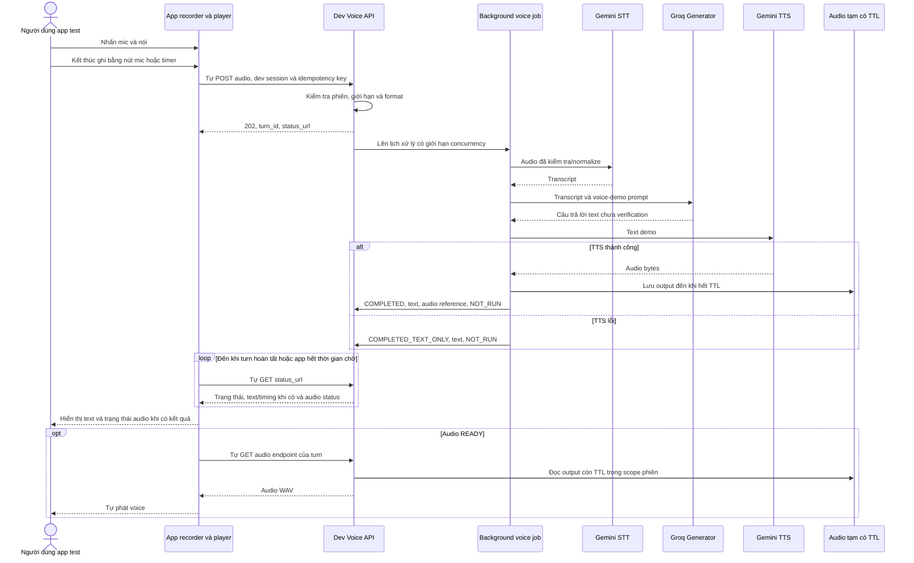

**Ranh giới bắt buộc của demo:**

- Endpoint/dev schema riêng, `mode="voice_demo"`, `verification_status="NOT_RUN"`; không dùng mặc định `PASS` của schema `Answer` hiện có và không tạo approved answer giả. App hiển thị rõ đang test voice-demo chưa kiểm chứng nội dung.
- Không làm suy yếu gate của `/v1` production. Sau này nối pipeline verified bằng service orchestration riêng; mọi câu trả lời nghiệp vụ game vẫn phải đáp ứng policy RAG-first, quyền/spoiler và Verifier/Gate.
- Dev routes chỉ bật trong development và chỉ nhận kết nối loopback. Demo local không yêu cầu token; mọi client local dùng chung caller và không có phân quyền theo người dùng. Không nhúng provider key hay `INTERNAL_SERVICE_TOKEN` vào app; trước khi test mobile qua mạng cần thiết kế auth/network phù hợp.
- Audio output phải được giữ để app tải/phát lại trong TTL cấu hình; không xóa ngay khi job tạo audio xong. Input và output có cleanup riêng; file gốc từ app không biến thành bản ghi lưu vĩnh viễn. Audio hết hạn trả trạng thái lỗi rõ ràng, không lộ đường dẫn filesystem.
- Có thể dùng in-memory turn/job store và thư mục audio local ignored trong POC một instance, chưa bắt buộc Supabase hoặc queue bền vững. Phải ghi rõ restart mất phiên/job, không hỗ trợ nhiều worker/process chia sẻ store; có task dọn file hết TTL. Đây không phải giải pháp persistence production.
- Service/provider hiện có lời gọi đồng bộ nên phải chạy trong worker/thread phù hợp hoặc refactor async có kiểm soát; không gọi blocking trực tiếp trong async route gây nghẽn event loop. Giới hạn active turn theo phiên, tổng concurrency, timeout và quota.

---

## 11. API-first Contract v1 (đề xuất)

### 11.1. Service endpoints cho Game Backend và web test

| Method | Endpoint | Chức năng | Response |
|---|---|---|---|
| `POST` | `/v1/conversations` | Tạo phiên | `201` + `conversation_id` |
| `GET` | `/v1/conversations/{id}` | Xem metadata phiên | `200` |
| `GET` | `/v1/conversations/{id}/turns` | Lịch sử được phép xem | `200` |
| `POST` | `/v1/conversations/{id}/turns` | Tạo turn văn bản | `202` + `turn_id` |
| `POST` | `/v1/conversations/{id}/voice-turns` | Tạo turn giọng nói (multipart) | `202` + `turn_id` |
| `GET` | `/v1/turns/{turn_id}` | Xem trạng thái, transcript, final answer | `200` |
| `GET` | `/v1/turns/{turn_id}/audio` | Lấy audio đã duyệt nếu có | `200/302`, auth |
| `POST` | `/v1/turns/{turn_id}/cancel` | Hủy turn đang chạy nếu hợp lệ | `202/409` |
| `GET` | `/v1/health` | Liveness (không cần auth, hạn chế data) | `200` |

**Access policy:** production endpoints chỉ nhận request từ Game Backend/API Gateway qua trusted service authentication; mobile client không gọi trực tiếp AI Guide Service. Web Test UI chỉ dùng endpoint test/debug đã giới hạn role/network policy. Game Backend chịu trách nhiệm xác thực player/session và cấp identity/context tối thiểu; AI Guide Service vẫn kiểm tra chữ ký, audience, expiry và scope của request nội bộ.

**Admin/debug (tách auth/role/network policy):** `/v1/admin/knowledge/sources`, `/v1/admin/knowledge/ingestions`, `/v1/admin/search/debug`, `/v1/admin/turns/{id}/trace`, `/v1/admin/evaluations`. Không mở các endpoint này cho mobile game.

### 11.2. Text turn — Request

```http
POST /v1/conversations/conv_123/turns
Authorization: Bearer <game_backend_service_token>
Idempotency-Key: e754e09e-84d4-45b8-bfda-84fe1bce7074
Content-Type: application/json
```

```json
{
  "message": "Tại sao Điệp Ức lại có hình dạng bướm?",
  "npc_id": "npc_memory_01",
  "location_id": "loc_001",
  "response_mode": "text_and_voice",
  "locale": "vi-VN"
}
```

Khi Game Backend gọi service, `player_id`, `story_access_level` và quyền liên quan chỉ đến từ trusted service token/context do Game Backend phát hành; AI Guide Service không tin các giá trị đó từ mobile client. `npc_id` và `location_id` vẫn là hints và phải đối chiếu lại với scope đã được cấp quyền.

### 11.3. Job accepted — Response

```json
{
  "turn_id": "turn_123",
  "conversation_id": "conv_123",
  "status": "PENDING",
  "status_url": "/v1/turns/turn_123"
}
```

### 11.4. GET turn — Completed Response

```json
{
  "turn_id": "turn_123",
  "status": "COMPLETED",
  "input": {"type": "text", "transcript": null},
  "answer": {
    "text": "Điệp Ức mang hình dạng bướm vì trong thế giới trò chơi, bướm tượng trưng cho việc truyền đi và biến đổi của ký ức.",
    "content_mode": "ROLEPLAY_GROUNDED",
    "verification_status": "PASS",
    "citations": [
      {
        "evidence_id": "ev_lore_01",
        "source_type": "game_lore",
        "title": "Saigon: Veilwake — tài liệu ý tưởng v1.0",
        "document_version": "1.0",
        "url": null
      }
    ]
  },
  "audio": {
    "status": "READY",
    "endpoint": "/v1/turns/turn_123/audio"
  },
  "request_id": "req_123"
}
```

Đây là **response minh họa**, không phải lời thoại canon đã được phê duyệt để đưa vào game.

### 11.5. Error format

```json
{
  "error": {
    "code": "EVIDENCE_INSUFFICIENT",
    "message": "Chưa đủ thông tin được xác minh để trả lời.",
    "request_id": "req_123",
    "retryable": false
  }
}
```

| HTTP | Ví dụ | Xử lý |
|---|---|---|
| `400/422` | Dữ liệu/format không hợp lệ | Sửa request |
| `401/403` | Chưa xác thực / không có quyền | Refresh token hoặc chặn |
| `404` | Không thấy object **trong scope user** | Không lộ object của người khác |
| `409` | Turn đang chạy / idempotency conflict | Poll/cancel/retry đúng key |
| `413/415` | Audio quá lớn / sai định dạng | Tối ưu upload |
| `429` | Vượt rate quota | Retry-After theo policy |
| `502/503/504` | Provider lỗi / timeout | Fallback/retry có giới hạn |

**Lưu ý:** `EVIDENCE_INSUFFICIENT` có thể dẫn tới một turn `COMPLETED` với câu trả lời giải thích trung thực, không nhất thiết phải là HTTP error; phân biệt **business outcome** và **system failure**.

### 11.6. Chế độ đồng bộ/bất đồng bộ

**Khuyến nghị:** public contract ưu tiên `202 + polling` từ ngày đầu để mobile chịu được kết nối chập chờn. Backend có thể hỗ trợ endpoint internal/debug đồng bộ cho test nhanh, nhưng không bắt client duy trì một request HTTP dài xuyên qua STT → web → LLM → TTS. Có thể bổ sung SSE/WebSocket **chỉ để báo trạng thái** về sau; không đồng nghĩa thoại realtime.

### 11.7. Dev Voice API contract cho app test — tách `/v1` verified

Các endpoint dưới đây là **contract dự kiến của milestone kế tiếp**, chưa phải route đã implement. App tự thực hiện request sau thao tác nút mic; UI không cần hiện khái niệm upload, `turn_id` hay polling cho người dùng.

| Method | Dev endpoint | Chức năng |
|---|---|---|
| `POST` | `/dev/v1/conversations` | Tạo phiên test trong scope caller |
| `POST` | `/dev/v1/conversations/{id}/turns` | Test text → Generator → text/voice, tùy `response_mode` |
| `POST` | `/dev/v1/conversations/{id}/voice-turns` | App tự gửi recording bằng multipart; nhận `202` + `turn_id` + `status_url` |
| `GET` | `/dev/v1/turns/{turn_id}` | Lấy status, transcript, answer, timing, audio status và lỗi an toàn |
| `GET` | `/dev/v1/turns/{turn_id}/audio` | Trả WAV còn TTL sau kiểm tra quyền của phiên test |

Dev turn response phải có `mode=voice_demo`, `verification_status=NOT_RUN` cho answer, không citation/approval giả và không trả raw provider error/key. `audio.endpoint` là đường API có quyền truy cập, không phải local file path. TTS lỗi vẫn trả text và `audio.status=UNAVAILABLE`; STT/Generator lỗi thì kết thúc turn bằng lỗi an toàn thay vì treo polling.

App tự polling với khoảng chờ/timeout giới hạn. Nếu hết thời gian chờ, app phân biệt “chưa lấy được kết quả” với “job đã thất bại”; không tự POST lại thành turn mới. Khi audio READY thì tự lấy/phát; lỗi tải/phát không làm mất text và cho phép thử phát lại khi audio còn TTL. Bản local hỗ trợ idempotency nhưng không phân quyền theo từng người dùng; cần thiết kế ownership khi mở rộng cho mobile.

Thông số MIME/codec, TTL, timeout, concurrency và session local được ghi trong tài liệu implementation; auth cho mobile là việc cần chốt sau. Mặc định tiếp tục turn-based; không thêm giao thức streaming hoặc phụ thuộc realtime cho milestone này.

---

## 12. Data Model (đề xuất logic)

### 12.1. ER Diagram

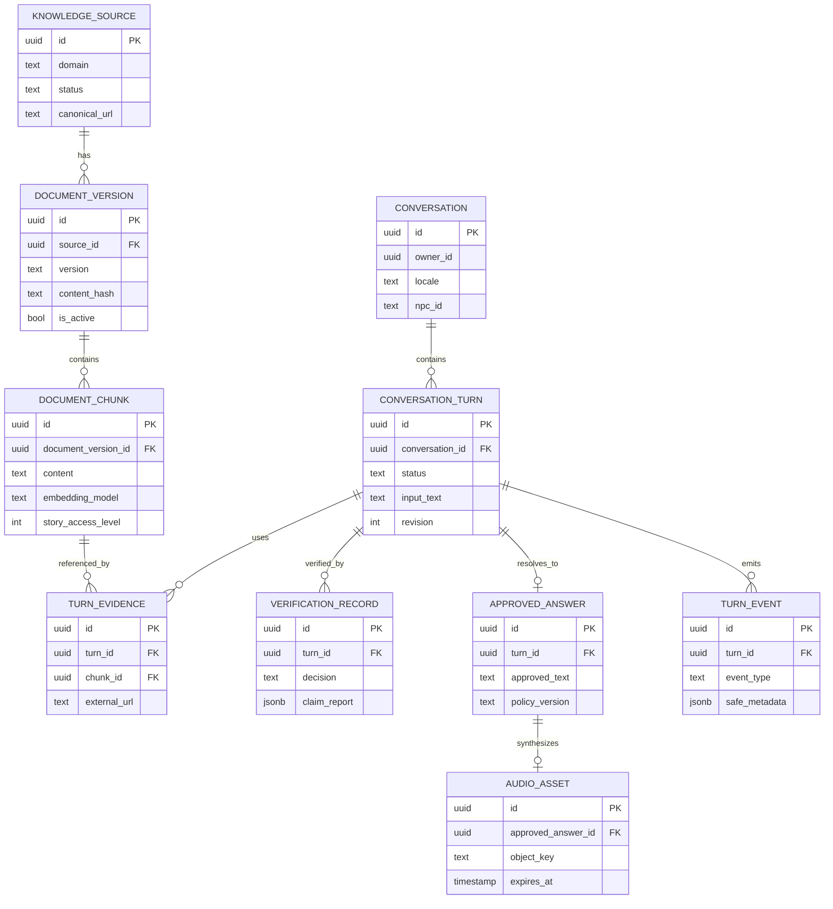

### 12.2. Những bảng cần bổ sung ngoài sơ đồ

- `web_evidence` cho snapshot/cache metadata, URL và thời điểm truy xuất, không buộc lưu vĩnh viễn nội dung có bản quyền.
- `ingestion_jobs` và `turn_jobs` cho queue/checkpoint/retry.
- `agent_configs`/`npc_personas` cho prompts version hóa và quyền tool.
- `evaluation_cases` và `evaluation_runs` cho dataset/metrics.
- `user_preferences` nếu thực sự cần lưu lựa chọn voice/ngôn ngữ.

### 12.3. Ví dụ SQL định hướng (không phải migration hoàn chỉnh)

```sql
-- Chỉ minh họa thiết kế; tên extension/schema phải khớp môi trường Supabase thực tế.
create extension if not exists vector with schema extensions;

create table if not exists public.document_chunks (
    id uuid primary key default gen_random_uuid(),
    document_version_id uuid not null,
    knowledge_domain text not null,
    content text not null,
    language text not null default 'vi',
    story_access_level integer not null default 0,
    metadata jsonb not null default '{}'::jsonb,
    embedding_model text not null,
    embedding extensions.vector(1536),
    created_at timestamptz not null default now()
);

-- 1536 chỉ là ví dụ, PHẢI đổi theo embedding model đã chọn.
-- Thiết kế final: thêm foreign keys, RLS, indexes, quyền role,
-- full-text strategy phù hợp tiếng Việt và migrations có version.
```

**Không được** cho public Supabase key truy xuất được tài liệu spoiler/private hoặc draft verification. Ưu tiên backend service role bảo mật kết hợp filters/authorization rõ ràng; nếu sử dụng Supabase RLS trực tiếp, thiết kế policy và test quyền truy cập theo từng tenant/player.

---

## 13. Architecture deployment & security

### 13.1. Mô hình triển khai đề xuất

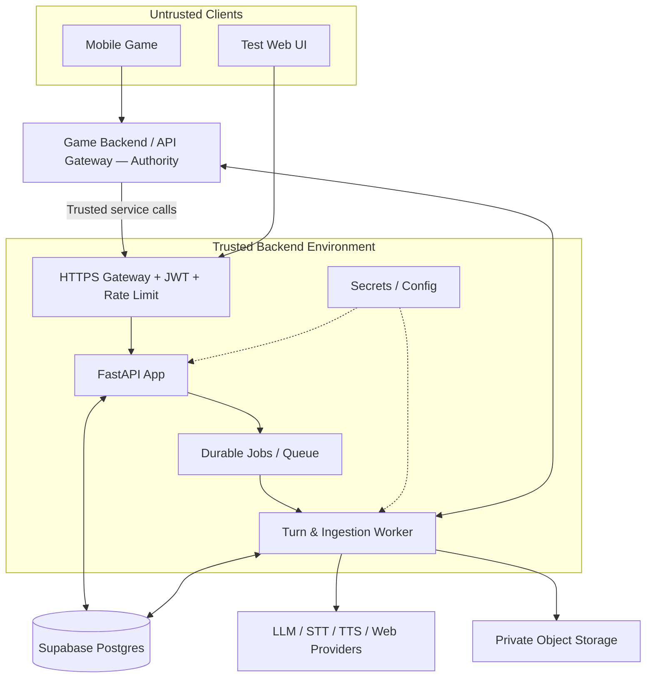

MVP verified có thể cùng host app/worker nếu khối lượng nhỏ, nhưng **không** dùng task chạy trong RAM của FastAPI như job store tin cậy cho một pipeline dài và nhiều retry. Worker có thể bắt đầu bằng queue đơn giản dựa trên PostgreSQL hoặc một managed queue; Redis/Celery là lựa chọn nâng cấp khi có nhu cầu. Riêng Dev Voice API Phase 0.5 cho phép in-memory store giới hạn một process để thử app trước DB/RAG, với giới hạn restart/TTL/concurrency công bố ở mục 10.3; không chuyển nguyên cách này thành production persistence.

### 13.2. Security checklist

- Xác thực service token/identity claims do Game Backend/API Gateway phát hành: signature/issuer/audience/expiry/scope; object-level authorization cho `conversation_id`, `turn_id`, `audio`.
- Admin route tách role, hạn chế mạng và ghi audit; chống cross-player data leaks.
- Rate limit per player/device/IP, concurrency cap, token budget, web search budget và upload constraints.
- SSRF defense cho URL fetch: chỉ http/https, chặn loopback/private/link-local/metadata IP, theo redirect, DNS re-resolution; ưu tiên allowlist khi có thể.
- Prompt injection defense: web/file là **data**, không là instructions; tool permissions tách khỏi văn bản nguồn.
- Kiểm tra MIME thực tế, file size/duration, malware scanning nơi cần thiết.
- Secrets nằm ở backend/secret manager; không đưa service role key/provider key vào client.
- PII minimization: ẩn danh trace, encryption in transit/at rest, TTL audio và cơ chế xóa session.
- Nội dung Web Search có ràng buộc về bản quyền/điều khoản; hiển thị trích dẫn, hạn chế lưu toàn văn khi không được phép.
- Spoiler/access tags phải được lọc ở tầng truy vấn, không chỉ bằng prompt.
- Quản lý prompt/config theo version; trace chi tiết không xuất ra public response.

**Safety bối cảnh game:** AI không ép người chơi di chuyển ban đêm, tới địa điểm nguy hiểm, băng đường khi nhìn AR; thông tin điểm đến cần cân nhắc giờ mở cửa, khả năng tiếp cận và an toàn theo nguyên tắc game v1.0.

---

## 14. Repository structure (Modular Monolith)

```text
saigon-veilwake-ai-backend/
├── app/
│   ├── main.py
│   ├── api/v1/
│   │   ├── conversations.py
│   │   ├── turns.py
│   │   ├── voice.py
│   │   ├── admin_knowledge.py
│   │   └── health.py
│   ├── core/
│   │   ├── config.py
│   │   ├── security.py
│   │   ├── errors.py
│   │   └── logging.py
│   ├── modules/
│   │   ├── orchestration/
│   │   ├── conversation/
│   │   ├── knowledge/
│   │   ├── query_router/
│   │   ├── retrieval/
│   │   ├── web_search/
│   │   ├── evidence/
│   │   ├── generation/
│   │   ├── verification/
│   │   ├── game_context/
│   │   ├── voice/
│   │   └── evaluation/
│   ├── integrations/
│   │   ├── database/
│   │   ├── llm/
│   │   ├── embeddings/
│   │   ├── search_providers/
│   │   ├── stt_providers/
│   │   ├── tts_providers/
│   │   ├── game_api/
│   │   └── object_storage/
│   ├── schemas/
│   ├── repositories/
│   └── workers/
├── migrations/
├── tests/
│   ├── unit/
│   ├── integration/
│   ├── contract/
│   ├── evaluation/
│   └── security/
├── scripts/
│   └── ingest_seed_knowledge.py
├── docs/
│   ├── adr/
│   ├── api/
│   ├── diagrams/
│   └── runbooks/
├── .env.example
├── pyproject.toml
├── docker-compose.yml
└── README.md
```

**Code layering:** `api` chỉ parse/validate + auth; `modules` chứa nghiệp vụ; `integrations` hiện thực provider adapters; `repositories` truy cập DB; `workers` chạy background jobs. Dùng dependency injection để unit test với mock providers. Web test UI có thể nằm ở repo riêng và chỉ gọi public/debug API được cấp quyền.

---

## 15. Testing, Evaluation & Observability

### 15.1. Test pyramid

| Cấp | Những trường hợp bắt buộc |
|---|---|
| Unit | Routing rules, spoiler filters, schema validation, gate fail-closed, TTL |
| Integration | DB vector query, search adapter, worker retries, audio storage |
| Contract | OpenAPI request/response compatibility, auth, idempotency, error models |
| RAG evaluation | Vietnamese query set; retrieval recall, ranking, source diversity |
| LLM verification | Supported/unsupported/contradicted, false accept/false reject |
| Security | Cross-user access, SSRF, prompt injection, leaked lore, forged client context |
| End-to-end | Text question; voice question; web current info; game hint; timeout/failure |

**Acceptance cho Dev Voice API/app test trước RAG:**

- Nhấn mic → nói → kết thúc ghi → app tự gửi → hiển thị transcript/answer → tự phát giọng phản hồi, không có bước chọn file/bấm Upload.
- Theo dõi đúng `202 + polling`; không mở mic/loa trên server; không hứa có streaming/VAD/memory chưa được implement.
- Mỗi lần ghi tạo một turn; retry cùng idempotency key không tạo thêm job/provider call cho cùng request trong vòng đời store test; bấm lặp khi đang xử lý được kiểm soát.
- Từ chối quyền mic, audio sai format/quá dài, lỗi upload, STT/Generator/TTS timeout/quota, mất mạng khi polling và lỗi phát audio đều có trạng thái rõ ràng. TTS lỗi vẫn giữ text.
- Response demo luôn mang `voice_demo` / `NOT_RUN`, không có `PASS` hoặc approved answer giả. Không gọi RAG/Web/Verifier/Supabase/game state thật trong milestone này.
- Chỉ đọc turn/audio trong scope phiên test; audio còn TTL tải được, hết TTL được xử lý rõ ràng và được dọn. Restart/một-process là giới hạn được ghi nhận, không coi in-memory job là durable.
- API/provider test dùng mock và không gọi mic/API thật. Kiểm thử app + provider thật là bước riêng trên thiết bị, dữ liệu và quyền gọi đã được cho phép.

### 15.2. Các chỉ số

| Layer | Metric | Ý nghĩa |
|---|---|---|
| Retrieval | Recall@K, MRR, nDCG@K | Chất lượng tìm kiếm/reranking |
| Answer | Grounded Claim Rate, Citation Precision | Nội dung gắn với chứng cứ |
| Verifier | False Accept Rate, False Reject Rate | Chất lượng gate kiểm chứng |
| Routing | Correct Source Selection | Chọn đúng Internal/Web/Game |
| Web fallback | Eligibility Accuracy / Unnecessary Web Calls | Chỉ gọi web khi RAG thiếu/quá cũ và domain/quyền cho phép; ca cấm web phải có 0 call |
| Spoiler | Leakage Rate | Tỷ lệ câu trả lời tiết lộ nội dung chưa mở |
| STT | WER/CER, proper-name accuracy | Nhận dạng tiếng Việt/tên riêng |
| TTS | Naturalness, pronunciation errors | Phát âm và cảm nhận nghe |
| Runtime | p50/p95 latency, timeout rate | Trải nghiệm turn-based |
| Cost | Cost/turn, web search calls/turn, tokens/turn | Ngân sách vận hành |

### 15.3. Bộ evaluation tối thiểu (đề xuất)

Chuẩn bị **ít nhất 100 câu** ban đầu (đây là kích thước thử nghiệm đề xuất, không phải chuẩn ngành):

- 20 câu canonical game lore; trong đó có câu kiểm tra spoiler.
- 20 câu lịch sử/văn hóa địa danh.
- 15 câu thông tin thay đổi theo thời gian.
- 15 câu pha trộn internal + web.
- 10 câu game-state/hints.
- 10 câu thiếu dữ liệu/mâu thuẫn.
- 10 câu voice tiếng Việt có giọng vùng miền/tên riêng.

Mỗi case gắn nhãn expected route, allowed sources, claims đúng/sai, quyền nhìn thấy, expected fallback, trạng thái evidence RAG/freshness và expected web-call behavior. Bao phủ đủ các acceptance cases ở mục 6.6, đặc biệt lore độc quyền không có trong corpus, tài liệu bị chặn quyền/spoiler, thông tin công khai thiếu/quá cũ, domain chưa rõ và retrieval error. Bộ kiểm thử phải có người duyệt chất lượng; không dùng cùng một LLM tạo test và tự chấm toàn bộ mà không giám sát.

### 15.4. Exit criteria đề xuất

- 100% ca test bắt buộc về **không tiết lộ spoiler** và **không trả draft ra API public** phải PASS trước pilot.
- 100% ca test lỗi verifier/timeout phải không phát answer chưa được duyệt.
- 100% ca cấm web ở mục 6.6 phải có **0 search/cache bypass**, gồm lore thiếu, nội dung vượt quyền/spoiler, game state và domain chưa rõ; không có raw lore riêng/game context lọt vào public search query.
- Có dashboard hoặc report cho latency từng stage, số Web Search calls và chi phí ước tính mỗi turn.
- Target retrieval/latency cụ thể chỉ được chốt **sau baseline trên tập dữ liệu và hạ tầng thực tế**; không gắn SLA tùy ý ngay ở proposal.

---

## 16. Hiệu năng, chi phí và tính khả dụng

**Latencies chính:** upload audio (nếu có) + STT + routing + retrieval/web + generator + verifier (+ revise) + TTS. Việc thêm Verifier tăng thời gian nhưng đáp ứng ràng buộc chất lượng. Bản thân RAG nhanh không đồng nghĩa toàn pipeline nhanh.

**Các đòn bẩy tối ưu, theo thứ tự:**

1. `DIRECT` template cho câu chào hỏi/định dạng đơn giản.
2. Thực hiện RAG-first và chỉ bổ sung web khi evidence công khai thiếu/quá cũ và gate cho phép; tránh web call không cần thiết. Có thể xử lý song song các subquestion độc lập trong phạm vi quyền, nhưng không khởi chạy web trước khi đánh giá RAG của chính subquestion đó.
3. Cache query embeddings, source metadata, web results theo TTL có phân loại.
4. Chỉ đưa evidence thực sự liên quan; giảm context và câu trả lời dài không cần thiết.
5. Giới hạn Web Search calls, LLM revisions, token generation, voice duration.
6. Tách `text ready` và `audio ready`; khi TTS chậm, client hiển thị text trước.
7. Generator/Verifier của MVP voice-first dùng **Groq Free Tier**; chọn model qua evaluation thực tế (chất lượng tiếng Việt, độ trễ, structured output và quota thực tế), không hardcode model ID vào domain core.

**Mô hình chi phí/turn** (các thành phần phải đo):

`cost_turn = cost_stt + cost_embedding_query + cost_search + cost_generator + cost_verifier + cost_tts + cost_storage_and_compute`

Nếu không có voice, `cost_stt = cost_tts = 0`; nếu không cần Web Search, `cost_search = 0`. Trong MVP Groq Free Tier, chi phí gọi LLM có thể bằng 0 trong quota nhưng **không được coi là quota vô hạn hoặc SLA**; phải đo số lượt gọi, token, `429`, latency và tỷ lệ fallback. Không đưa bảng giá số cố định vào proposal vì giá và model/provider thay đổi theo thời điểm.

---

## 17. Roadmap triển khai backend

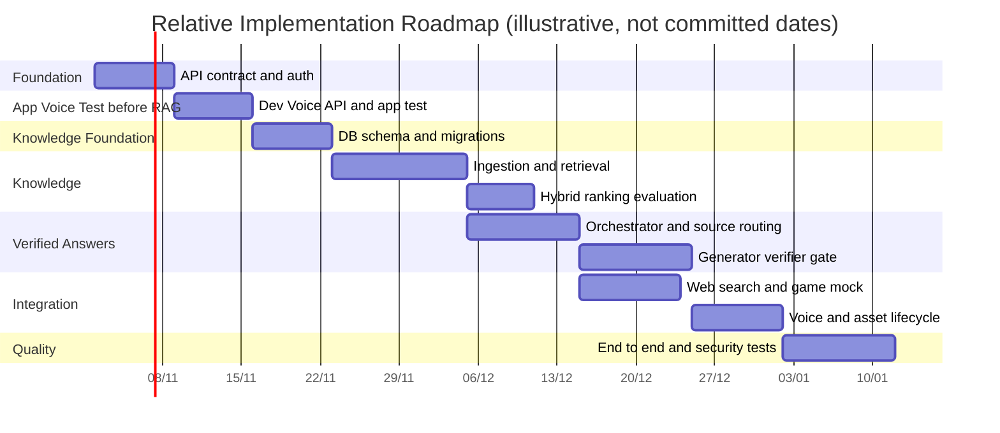

*Gantt trên chỉ mô tả **phụ thuộc và thứ tự tương đối**; các ngày và số ngày minh họa, **không phải cam kết thời gian thực hiện**.*

### Phase 0 — Contracts & Voice-first Skeleton

**Deliverables:** OpenAPI draft gồm `voice-turns`; auth/middleware; module interfaces; `.env.example`; test harness; CI; skeleton FastAPI.  
**Definition of Done:** gọi được `/health`, tạo conversation/text-turn/voice-turn fake, xác thực service-to-service và status response nhất quán; chưa được giả transcript hoặc audio khi adapter chưa tồn tại.

### Phase 0.5 — Dev Voice API & App Test trước RAG

**Trạng thái hiện tại:** Terminal Voice Loop POC đã được người dùng xác nhận nghe/nói thành công. Dev Voice API và Web UI local đã implement, kiểm thử bằng mock; `/v1` vẫn mock. Bước còn lại của milestone là xác nhận browser E2E với provider thật và tích hợp mobile theo contract; chưa bắt đầu RAG/DB. Chi tiết thông số đã triển khai nằm trong [Dev Voice API + Local UI](Dev_Voice_API_Local_UI.md).

**Thứ tự task:**

1. Chốt contract dev ở mục 11.7: input codec/format từ recorder thật của app, session/auth, status/error schema có `NOT_RUN`, idempotency, timeout và audio TTL.
2. Tạo dev routes/turn store/background execution có giới hạn; nối ba provider và orchestration đã test, không gọi script terminal để xử lý request. Giữ riêng `/v1` verified, không làm thay đổi mock thành câu trả lời chưa kiểm chứng mang `PASS`.
3. Bổ sung audio endpoint có ownership/TTL; cleanup input/output đúng thời điểm; test provider/API bằng mock và kiểm tra lỗi, quota, concurrency, duplicate request.
4. Nối app: nút mic ghi/dừng → tự POST audio → tự polling → hiển thị text → tự tải/phát WAV; xử lý quyền mic, kết nối mạng, loading và thử lại có kiểm soát. Không cần màn hình chọn file/upload.
5. Test trên app/thiết bị thật với provider được phép gọi; ghi nhận format, timing, lỗi thiết bị/mạng và chất lượng playback. Chưa gọi hệ thống game hoặc gửi lore riêng trong demo.

**Definition of Done:** người dùng nói trên app và nghe được phản hồi thật qua Dev Voice API; không thao tác file/upload thủ công; transcript/answer/timing hiển thị được; TTS lỗi vẫn có text; ca lỗi không treo polling hoặc lặp chi phí vô hạn; đáp ứng acceptance ở mục 15.1. Không yêu cầu Supabase, RAG, Web Search, Verifier, streaming hoặc memory để hoàn tất milestone test này.

Sau Phase 0.5, tiếp tục Phase 1–3 để đưa evidence, RAG-first/web fallback và Verifier vào pipeline. Dev API thành công không đồng nghĩa Verified AI Guide đã hoàn thành; production release vẫn theo các gate và ranh giới Game Backend bên dưới.

### Phase 1 — Knowledge & Retrieval

**Deliverables:** source approval, ingestion seed từ lore v1.0 và nguồn văn hóa được cấp phép, PostgreSQL/pgvector, basic hybrid retrieval, reranker adapter, debug search.  
**Definition of Done:** trả Top-K có provenance; filter spoiler/domain hoạt động; chạy được offline với fixture.

### Phase 2 — Verified Voice-first MVP

**Deliverables:** query router với domain classification, RAG sufficiency/freshness và backend web-eligibility gate; conversation memory, Groq `LLM Provider Adapter`, generator, claim verifier, verification gate, quota/rate-limit guard, error/fallback, STT/TTS adapters, voice-turn API async và private audio storage. Trước khi B10 được nối ở Phase 3, nhánh web được mock hoặc tắt có chủ đích; không giả đã search.  
**Definition of Done:** nói tiếng Việt → transcript → verified text → voice; phát hiện unsupported claim; không trả draft; 1 vòng revision; citations đầy đủ; xử lý `429`/timeout bằng retry có giới hạn hoặc fallback đã duyệt; lỗi TTS vẫn có text; API key không xuất hiện ở client/log. Policy test xác nhận RAG đủ thì không yêu cầu web; lore/game state/blocked/unknown domain không thể mở web.

### Phase 3 — External Search & Game Integration

**Deliverables:** Web Search adapter chỉ nhận subquery công khai còn thiếu/quá cũ đã qua eligibility gate; source validation, TTL cache sau policy check, Game Context mock/live interface, evidence aggregation theo domain và trace lý do fallback.  
**Definition of Done:** xử lý được câu hỏi internal + current web + game access theo thứ tự RAG-first; toàn bộ acceptance cases ở mục 6.6 PASS; chỉ bổ sung web khi cần và được phép; không tìm web cho lore độc quyền hoặc để vượt spoiler/quyền; có fallback khi nguồn mâu thuẫn, thiếu dữ liệu hoặc hết quota.

### Phase 4 — Voice Client Test & Audio Hardening

**Deliverables:** minimal web/mobile harness, test giọng vùng miền/tên riêng, audio TTL/signed URL và đánh giá chất lượng nghe.  
**Definition of Done:** voice MVP chạy được qua Game Backend; audio không bị truy cập chéo người chơi; lỗi TTS vẫn có text.

### Phase 5 — Hardening/Pilot

**Deliverables:** evaluation report, hardening security, cost/latency instrumentation, deploy/runbooks và test tích hợp mobile.  
**Definition of Done:** contract tests và security gates PASS; có số liệu baseline và phản hồi pilot.

---

## 18. Rủi ro và biện pháp giảm thiểu

| Rủi ro | Hậu quả | Giảm thiểu |
|---|---|---|
| Verifier chấp thuận thông tin sai | Misinformation | Claim-level + citations + golden tests + source quality |
| Web result cũ/sai | Giờ mở cửa/giá vé sai | Freshness fields, ưu tiên nguồn chính thức, abstain |
| Prompt injection qua web/file | Điều khiển agent ngoài ý định | Untrusted data boundary, allowlist tools, SSRF defense |
| Lore leak vượt chapter | Spoiler | Pre-retrieval security filters, tests, least privilege |
| RAG miss bị tự động chuyển sang web | Lộ lore riêng trong query, bịa canon từ nguồn công khai hoặc vượt spoiler | Domain classification + backend eligibility gate; lore/game state/blocked/unknown domain mặc định không web; test 0 call và kiểm tra subquery |
| Backend tự “thưởng” nhiệm vụ | Game exploit | Read-only Game Adapter; Game Backend authoritative |
| STT nhận sai tên riêng | Trả lời sai chủ đề | Domain lexicon, confirmation khi không chắc |
| TTS đọc draft | Thông tin sai đến người dùng | Strict `approved_answer_id` input contract |
| Truy vấn lâu/timeouts | UX kém, request fail | Async job, polling, deadlines, partial text-first |
| Queue mất job/duplicate | Chi phí/lỗi dữ liệu | Durable persistence + idempotency + retries |
| Supabase policy sai | Rò rỉ dữ liệu/lore | RLS tests, backend-only admin keys, scope checks |
| Search/web API hết quota | Không đủ bằng chứng | Provider adapter, budget cap, qualified fallback |
| Groq Free Tier hết quota/thay đổi giới hạn hoặc model | Turn thất bại, trải nghiệm gián đoạn | Quota guard, metrics `429`, cache/template, fallback đã duyệt; giữ `LLM Provider Adapter` để thay provider sau benchmark |
| Gửi context/lore dư thừa tới LLM provider | Lộ nội dung game hoặc dữ liệu người chơi | Data minimization, redact PII, chỉ gửi evidence đã lọc quyền; không gửi JWT/raw game state |
| Over-engineering | Trễ MVP | Modular monolith; xây P0 trước và benchmark |

---

## 19. Architecture Decision Records (ADR) — bảng chờ chốt

| ADR | Quyết định | Đề xuất hiện tại | Trạng thái |
|---|---|---|---|
| ADR-001 | Backend form | FastAPI Modular Monolith | Đề xuất |
| ADR-002 | Public interface | REST HTTPS + version `/v1` | Đề xuất |
| ADR-003 | Job execution | Durable async jobs + polling | Đề xuất |
| ADR-004 | Primary DB | Supabase PostgreSQL + pgvector | **Đã xác định cho MVP** |
| ADR-005 | Retrieval | Hybrid Search + configurable Reranker | Đề xuất |
| ADR-006 | Source routing | RAG-first; đánh giá sufficiency/freshness rồi mới xét web eligibility cho public subquery thiếu/quá cũ; Game State/Direct riêng; unknown domain hỏi lại | **Policy đã chốt 28/10/2026**; classifier/ngưỡng chờ triển khai/evaluation |
| ADR-007 | Web Search | Fallback có điều kiện; không thay canon, không bypass quyền/spoiler; provider-agnostic adapter, bắt đầu 1 provider | **Fallback policy đã chốt**; search provider/chính sách budget cụ thể chờ benchmark |
| ADR-008 | Answer validation | Independent LLM Verifier + deterministic Gate | **Bắt buộc theo yêu cầu**, chi tiết chờ chốt |
| ADR-009 | Verification policy | Fail-closed, max 1 revision | Đề xuất |
| ADR-010 | Voice | Turn-based; MVP STT → verified text → TTS; Dev Voice API STT → Generator → TTS với `NOT_RUN` tách riêng | **Đã xác định**, phân biệt demo/verified |
| ADR-011 | Game authority | Game Backend giữ state/rewards; AI read-only MVP | Đề xuất quan trọng |
| ADR-012 | Web client | Thin testing harness, riêng khỏi backend core | **Đã xác định** |
| ADR-013 | Security | JWT, object auth, spoiler filters, rate limit | Đề xuất bắt buộc |
| ADR-014 | Evaluation | Golden test set + traces & stage metrics | Đề xuất |
| ADR-015 | MVP Generator/Verifier provider | Groq Free Tier qua provider adapter; model ID chọn bằng benchmark/config, quota exhaustion phải fail safely | **Đã xác định cho MVP** |
| ADR-017 | MVP voice scope | Voice-in/voice-out là P0; STT Gemini `gemini-3.5-transcribe` (`vi-VN`), TTS Gemini `gemini-3.8-flash-lite-tts`, adapter riêng; đánh giá tên riêng/quota/dữ liệu trước pilot | **Provider đã chốt; Terminal POC đã test**, MVP verified chưa hoàn thành |
| ADR-016 | Service boundary | AI Guide Service chỉ sở hữu trải nghiệm AI Guide; Game Backend sở hữu identity, gameplay, state/rewards và public game API | **Đã xác định** |
| ADR-018 | App voice UX | Nhấn mic để ghi, kết thúc ghi thì app tự gửi, tự theo dõi kết quả và tự phát audio; không chọn file/bấm Upload; không streaming trong lúc nói | **Đã chốt 28/10/2026**; kiểu nhấn giữ/thả hoặc nhấn bắt đầu/dừng là lựa chọn interaction |
| ADR-019 | Next milestone before RAG | Dev Voice API riêng + app test, `202 + polling`, audio có TTL, `voice_demo` / `NOT_RUN`; chưa RAG/Web/Verifier/Supabase và không expose production | **API + Web UI local đã implement**; WAV PCM16, không token, chỉ loopback, TTL 600s, timeout 120s, một worker; chờ browser E2E/mobile và auth mobile |

---

## 20. Những vấn đề chưa chốt cần đánh giá tuần tự

1. **Integration authentication:** Game Backend/API Gateway phát hành/xác nhận trusted service token và truyền identity/context tối thiểu như thế nào? Cần chốt claims, audience, token exchange, session ownership và RLS mapping.
2. **Game Backend hiện có:** API game state chưa được cung cấp; cần xác định mapping ID, schema quest/chapter, quyền NPC và hint policies.
3. **Knowledge corpus:** danh sách website/tài liệu văn hóa được phép, phạm vi địa điểm ưu tiên; hiện mới có lore doc v1.0.
4. **Embedding tiếng Việt:** so sánh 2–3 phương án bằng Recall@K trên tập test thật; từ đó quyết định vector dimension/index.
5. **Keyword retrieval tiếng Việt:** benchmark FTS `simple`, normalization và cơ chế tokenizer nếu cần.
6. **Reranker:** chọn cross-encoder/model đa ngôn ngữ theo chất lượng và latency.
7. **Web provider & Places data:** đánh giá chất lượng địa danh Việt Nam, giá, metadata, điều khoản.
8. **Model Generator/Verifier trên Groq Free Tier:** benchmark model khả dụng về tiếng Việt, false-accept/false-reject, structured outputs, latency và quota; model ID nằm trong config, không khóa vào domain core.
9. **STT/TTS tiếng Việt:** provider POC đã chốt và test đường cơ bản với Gemini STT/TTS; tiếp tục benchmark tên riêng, địa danh, giọng vùng miền, độ trễ và quota trước pilot. Với app test, chốt format recorder/normalization, kiểu thao tác nút mic, dev auth/session, TTL và timeout ở Phase 0.5. Nếu dùng free tier của provider bên thứ ba, phải có phê duyệt rõ ràng về việc gửi audio/transcript/lore; không dùng token ứng dụng consumer hay cách lách vùng địa lý cho backend.
10. **Deployment constraints:** ngân sách, máy chủ, dữ liệu cá nhân, quyền truy cập, lưu giữ audio và SLA mong muốn.

**Thứ tự triển khai đã điều chỉnh:** Terminal Voice POC đã hoạt động → chốt dev API contract/recorder format → **Phase 0.5 Dev Voice API + app test với UX nhấn mic, tự gửi và tự phát** → knowledge schema/ingestion/retrieval → RAG-first routing với web eligibility → Generator/Verifier/Gate → web fallback thật có điều kiện → tích hợp verified voice vào Game Backend. Có thể chuẩn bị seed dataset trong lúc làm app test; không bắt app test chờ đủ RAG hoặc game integration. Voice adapter hiện có được tái sử dụng, không xây lại từ đầu.

---

## 21. Tài liệu tham khảo và cơ sở kiểm chứng

### 21.1. Tài liệu nội bộ

- *Saigon: Veilwake — Bản chốt ý tưởng, thế giới quan và cơ chế trò chơi*, v1.0, 25/10/2026. Tài liệu do nhóm cung cấp; nguồn cho lore, NPC, cơ chế nhiệm vụ, an toàn và ranh giới hư cấu/thực tế.

### 21.2. Tài liệu kỹ thuật công khai (đã đối chiếu 27/10/2026)

- [FastAPI — Bigger Applications / APIRouter](https://fastapi.tiangolo.com/tutorial/bigger-applications/): tổ chức modular API.
- [Supabase — Hybrid Search](https://supabase.com/docs/guides/ai/hybrid-search): keyword + semantic search, RRF và PostgreSQL.
- [Supabase — pgvector](https://supabase.com/docs/guides/database/extensions/pgvector): lưu và truy vấn embeddings.
- [Supabase — Full Text Search](https://supabase.com/docs/guides/database/full-text-search): PostgreSQL FTS; ví dụ mặc định thường là tiếng Anh, cần điều chỉnh cho tiếng Việt.
- [OpenAI — Audio API Reference](https://platform.openai.com/docs/api-reference/audio): endpoint transcription/speech, chỉ dùng như một provider reference.
- [OpenAI — Speech to Text](https://platform.openai.com/docs/guides/speech-to-text): file transcription.
- [OpenAI — Text to Speech](https://platform.openai.com/docs/guides/text-to-speech): tạo giọng nói từ văn bản.
- [OpenAI — Structured Outputs](https://platform.openai.com/docs/guides/structured-outputs): schema cho verifier, không đồng nghĩa kiểm chứng sự thật.
- [Groq — Structured Outputs](https://console.groq.com/docs/structured-outputs): JSON Schema cho các model hỗ trợ; vẫn cần validation/gate phía backend.
- [Groq — Rate Limits](https://console.groq.com/docs/rate-limits): quota/rate limit là giới hạn theo account/model, cần quan sát và xử lý `429`.
- [Groq — Your Data](https://console.groq.com/docs/your-data): chính sách lưu giữ dữ liệu và Zero Data Retention; vẫn áp dụng nguyên tắc giảm thiểu dữ liệu gửi đi.
- [Tavily Search API](https://docs.tavily.com/documentation/api-reference/endpoint/search): một phương án Search Provider.
- [Brave Search API](https://api-dashboard.search.brave.com/app/documentation/web-search/get-started): một phương án Search Provider.
- [OWASP Top 10 for LLM Applications](https://owasp.org/www-project-top-10-for-large-language-model-applications/): prompt injection, lộ thông tin và các rủi ro ứng dụng LLM.

### 21.3. Phân biệt độ chắc chắn

- **Theo tài liệu game:** các thuật ngữ, cốt truyện mùa đầu, nguyên tắc không gây ảnh hưởng chuyến đi, AI không tự đổi lời giải vụ án.
- **Theo tài liệu kỹ thuật công khai:** khả năng của FastAPI, PostgreSQL/pgvector, các provider API và nhóm rủi ro LLM.
- **Policy nguồn đã được người dùng chốt ngày 28/10/2026:** ưu tiên RAG; chỉ web fallback khi evidence thiếu/quá cũ và domain/quyền cho phép; lore độc quyền và game state không dùng web thay thế, không bypass spoiler/access filter. Đây là quyết định thiết kế, chưa đồng nghĩa routing/Web Search đã được implement hoặc kiểm thử.
- **Voice/app đã chốt ngày 28/10/2026:** người dùng nhấn mic để nói, app tự gửi sau khi ghi xong và tự phát phản hồi; bước tiếp theo là Dev Voice API trước RAG. Terminal POC được người dùng xác nhận hoạt động; Dev Voice API/app contract mới là kế hoạch, chưa phải implementation. Demo dùng `NOT_RUN`, không phải ngoại lệ cho phép release draft của MVP/production.
- **Là đề xuất kiến trúc chưa kiểm thử:** sơ đồ triển khai, module IDs, routes, JSON contracts, database schema, số Top-K, classifier/ngưỡng sufficiency/freshness, số lần revision, roadmap, chỉ tiêu đánh giá và lựa chọn provider chưa chốt.

---

## 22. Kết luận / Proposed baseline

**Baseline được đề xuất:**

> **Mobile Game → Game Backend / API Gateway (identity + gameplay authority) → AI Guide Service (FastAPI) → [STT nếu voice input] → Turn Orchestrator → Source Router (domain + quyền) → Internal RAG trước → Evidence Sufficiency/Freshness → [Web Search/External API chỉ khi evidence công khai thiếu/quá cũ và backend cho phép] → Evidence Package → Groq Free Tier Generator LLM → Groq Free Tier Verifier LLM → Deterministic Verification Gate → Approved Text → TTS nếu user yêu cầu voice → Game Backend / Client**. `GAME_STATE` đi riêng tới Game Backend đã cấp quyền; `DIRECT` dùng template; domain chưa rõ thì hỏi lại. Lore/canon độc quyền thiếu dữ liệu hoặc nội dung bị chặn spoiler/quyền không được fallback sang web. TTS chỉ được gọi từ `approved_answer_id`; lỗi TTS trả text đã duyệt, không đọc draft.

AI Guide Service cần được đánh giá theo **chất lượng bằng chứng, độ an toàn của thông tin được phép tiết lộ, tỷ lệ chặn claim sai, độ trễ, chi phí và độ tin cậy của API**, không chỉ mức độ tự nhiên của lời thoại. Tách service chuyên trách giúp tích hợp AI Guide vào Game Backend mà không đưa RAG/LLM logic vào gameplay core hoặc mobile client.

**Bước triển khai tiếp theo ở trạng thái hiện tại:** hoàn thành **Phase 0.5 — Dev Voice API & App Test trước RAG** theo ADR-018/019: app nhấn mic → ghi xong tự gửi → backend chạy STT/Groq/TTS hiện có → app hiển thị text và tự phát audio. Dùng endpoint/schema demo riêng với `NOT_RUN`, không đổi policy verified của `/v1`. Sau khi kiểm chứng app end-to-end, tiếp tục Supabase/ingestion/RAG-first, web fallback có điều kiện và Verifier/Gate để đạt baseline MVP phía trên.
