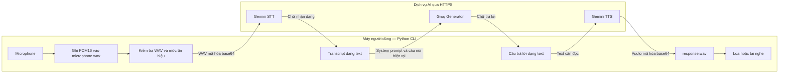
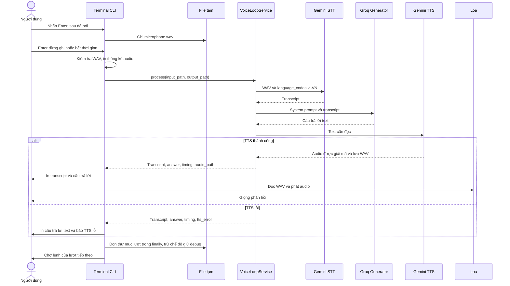
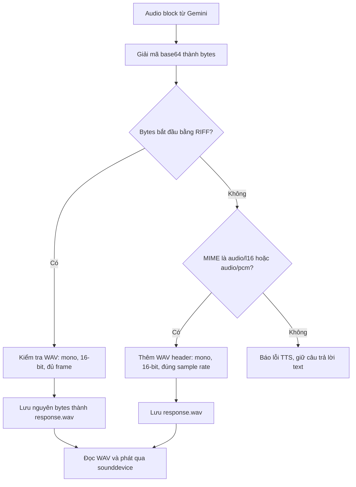
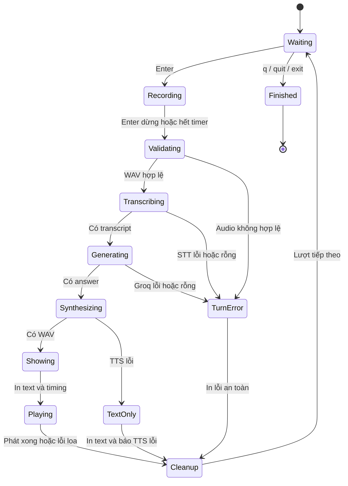
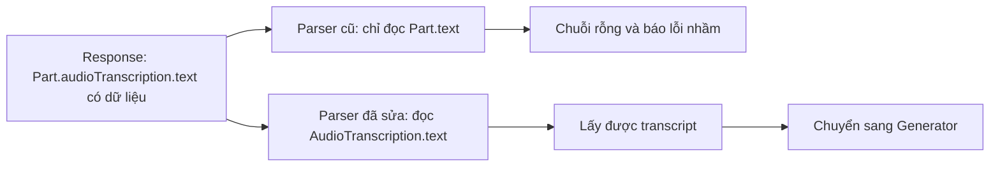

# Terminal Voice Loop POC — Giải thích kiến trúc và cơ chế hoạt động

Ngày cập nhật: **28/10/2026**. Tài liệu mô tả code hiện có trong repository.
Người dùng đã xác nhận chạy được toàn bộ luồng: nói vào microphone, nhận câu trả lời
text và nghe audio phản hồi rõ ràng. Đây là kết quả kiểm thử thủ công do người dùng
xác nhận; bộ unit test được mô tả riêng ở cuối tài liệu.

## Mục lục

1. [Hệ thống đang làm gì?](#1-he-thong-dang-lam-gi)
2. [Sơ đồ tổng thể](#2-so-do-tong-the)
3. [Các file và trách nhiệm](#3-cac-file-va-trach-nhiem)
4. [Một lượt hội thoại diễn ra như thế nào?](#4-mot-luot-hoi-thoai-dien-ra-nhu-the-nao)
5. [Microphone và audio số](#5-microphone-va-audio-so)
6. [Gemini STT: từ âm thanh thành chữ](#6-gemini-stt-tu-am-thanh-thanh-chu)
7. [Groq Generator: từ câu hỏi thành câu trả lời](#7-groq-generator-tu-cau-hoi-thanh-cau-tra-loi)
8. [Gemini TTS: từ chữ thành giọng nói](#8-gemini-tts-tu-chu-thanh-giong-noi)
9. [Trạng thái, lỗi và thời gian xử lý](#9-trang-thai-loi-va-thoi-gian-xu-ly)
10. [File tạm, dữ liệu và API key](#10-file-tam-du-lieu-va-api-key)
11. [Cấu hình và cách chạy](#11-cau-hinh-va-cach-chay)
12. [Lỗi transcript rỗng đã được sửa ra sao?](#12-loi-transcript-rong-da-duoc-sua-ra-sao)
13. [Kiểm thử, giới hạn và cách đọc code](#13-kiem-thu-gioi-han-va-cach-doc-code)

Các sơ đồ dùng **Mermaid**. Mở Markdown Preview bằng trình đọc hỗ trợ Mermaid để xem
diagram; nếu trình đọc chưa hỗ trợ, các khối vẫn hiển thị mã sơ đồ dạng text.

<a id="1-he-thong-dang-lam-gi"></a>

## 1. Hệ thống đang làm gì?

POC là một chương trình Python chạy trong terminal. Bạn nói một câu, chương trình ghi
âm thành WAV, gửi đi nhận dạng lời nói, tạo câu trả lời, rồi tạo và phát giọng đọc.

Ba nhiệm vụ AI được tách riêng:

| Thành phần | Nhận vào | Trả về | Provider/model |
| --- | --- | --- | --- |
| STT — Speech-to-Text | Audio chứa lời nói | Transcript: chữ nhận dạng được | Gemini `gemini-3.5-transcribe`, hint `vi-VN` |
| Generator — mô hình ngôn ngữ | Transcript và system prompt | Câu trả lời dạng chữ | Groq, model lấy từ `GROQ_GENERATOR_MODEL` |
| TTS — Text-to-Speech | Câu trả lời dạng chữ | Audio giọng đọc | Gemini `gemini-3.8-flash-lite-tts` |

Ví dụ minh họa, không phải output cố định của mô hình:

```text
Bạn nói:       "Gợi ý cho tôi một cách học tiếng Anh mỗi ngày."
STT trả chữ:   "Gợi ý cho tôi một cách học tiếng Anh mỗi ngày."
Groq trả lời:  "Bạn có thể dành mười phút mỗi ngày để nghe và nhắc lại một đoạn ngắn."
TTS tạo audio: Giọng đọc câu trả lời đó.
```

Chương trình không tự huấn luyện mô hình trên máy. Máy của bạn thu/phát audio và điều
phối request; các mô hình AI chạy tại dịch vụ Gemini và Groq.

**Loop nhiều lượt chưa đồng nghĩa với có trí nhớ hội thoại.** Mỗi request Groq hiện
chỉ chứa system prompt và transcript của lượt đang xử lý. Câu hỏi trước/câu trả lời
trước không được tự động gửi lại. Một câu như “giải thích thêm ý thứ hai lúc nãy” có
thể thiếu ngữ cảnh dù terminal vẫn đang mở.

POC này chưa tích hợp RAG, Supabase, lore/canon, spoiler filter, Game Backend,
Verifier hoặc web UI. Các route FastAPI khác trong repository không nằm trên đường
chạy của `python scripts/voice_loop.py`.

<a id="2-so-do-tong-the"></a>

## 2. Sơ đồ tổng thể



Ở lượt thành công thông thường, chương trình thực hiện ba thao tác suy luận:
một STT, một Generator và một TTS, theo thứ tự. Groq nhận **text**, không nhận bản
ghi âm microphone. Khi một bước trước thất bại, các bước phụ thuộc phía sau không
được tiếp tục.

Gemini STT/TTS dùng REST với `httpx`. Generator dùng Groq Python SDK. Việc tách này
giúp tránh lệ thuộc vào các field cấu hình mới chưa có trong bản Google SDK cũ.

<a id="3-cac-file-va-trach-nhiem"></a>

## 3. Các file và trách nhiệm

| File | Trách nhiệm chính |
| --- | --- |
| [scripts/voice_loop.py](../scripts/voice_loop.py) | Đọc flag, hướng dẫn terminal, ghi mic, phát loa, tạo/xóa thư mục tạm |
| [app/modules/voice_loop/service.py](../app/modules/voice_loop/service.py) | Điều phối STT → Generator → TTS, đo thời gian, giữ text nếu TTS lỗi |
| [app/modules/voice_loop/audio.py](../app/modules/voice_loop/audio.py) | Đọc/kiểm tra WAV, tính duration, RMS và peak |
| [app/integrations/stt_providers/gemini_stt.py](../app/integrations/stt_providers/gemini_stt.py) | Tạo request STT và đọc transcript từ response |
| [app/integrations/llm/groq_generator.py](../app/integrations/llm/groq_generator.py) | Giữ system prompt và gọi Groq Chat Completions |
| [app/integrations/tts_providers/gemini_tts.py](../app/integrations/tts_providers/gemini_tts.py) | Tạo request TTS, giải mã audio và lưu WAV hợp lệ |
| [app/integrations/gemini_rest.py](../app/integrations/gemini_rest.py) | Gọi HTTPS, xử lý lỗi an toàn, đọc output block và token diagnostics |
| [app/integrations/errors.py](../app/integrations/errors.py) | Kiểu lỗi `ProviderRequestError` có thông báo phù hợp để đưa ra terminal |
| [app/core/config.py](../app/core/config.py) | Đọc settings từ môi trường và `.env` bằng `pydantic-settings` |
| [scripts/diagnose_stt.py](../scripts/diagnose_stt.py) | Công cụ riêng để đối chiếu response STT bằng WAV đã lưu |

### Vì sao có service và adapter riêng?

`VoiceLoopService` chỉ cần ba hành vi:

```python
transcript = stt.transcribe(input_audio_path, language_code="vi-VN")
answer = generator.generate(transcript)
audio_path = tts.synthesize(answer, output_audio_path)
```

Service không cần biết base64, HTTP header, cách chọn sound card hoặc WAV header.
Adapter giải quyết chi tiết provider; CLI giải quyết tương tác với người dùng.

Các `Protocol` trong service mô tả giao diện mà provider phải đáp ứng. Unit test có
thể thay provider bằng mock/stub cùng giao diện, nên kiểm tra được luồng điều phối
mà không cần mạng, API key hay microphone thật.

`build_voice_loop_service(settings)` kiểm tra đủ key/model trước, rồi lắp ba provider
vào service. Khi thiếu cấu hình, thông báo nêu **tên biến** còn thiếu, không in giá trị.

<a id="4-mot-luot-hoi-thoai-dien-ra-nhu-the-nao"></a>

## 4. Một lượt hội thoại diễn ra như thế nào?



Luồng chi tiết:

1. `main()` tải cấu hình và tạo service. `--list-devices` hoặc `--record-only` có thể
   đi theo nhánh riêng không cần khởi tạo provider.
2. CLI chờ Enter. Mỗi lượt có một thư mục UUID riêng trong `.voice_loop_tmp/`.
3. `record_wav()` mở input stream, gom các buffer PCM và lưu `microphone.wav` khi dừng.
4. `inspect_wav()` kiểm tra audio trước khi gửi mạng. CLI hiển thị số giây, sample rate,
   RMS và peak; có thể phát lại input nếu dùng `--play-input`.
5. Service lần lượt lấy transcript, lấy answer và tạo voice. Mỗi bước có đồng hồ riêng.
6. CLI nhận `VoiceLoopResult`, in text/timing rồi phát `response.wav` nếu có.
7. Khối `finally` chạy cả khi lượt thành công hoặc gặp lỗi để thực hiện chính sách file tạm.

**Thời điểm hiển thị text:** trong luồng đầy đủ hiện tại, transcript và answer được in
sau khi `service.process()` trả về, tức sau khi TTS thành công hoặc báo lỗi. Chúng chưa
được in ngay khi STT/Groq vừa hoàn tất. Với `--stt-only`, transcript được in ngay sau STT.

<a id="5-microphone-va-audio-so"></a>

## 5. Microphone và audio số

### 5.1 Thu âm thành dữ liệu

Microphone và driver âm thanh chuyển tín hiệu giọng nói thành chuỗi số đo biên độ.
`sounddevice.InputStream` đưa từng buffer dữ liệu cho callback của Python.

POC ghi với các thông số cố định:

| Thuộc tính | Giá trị | Ý nghĩa |
| --- | --- | --- |
| Sample rate | `16000 Hz` | 16.000 mẫu biên độ trong một giây |
| Channels | `1`, mono | Một kênh audio |
| Sample format | `int16`, PCM16 | Mỗi mẫu là số nguyên có dấu, dài 2 byte |
| Thời gian mặc định | `25 giây` | Tự dừng nếu người dùng không nhấn Enter |
| `--max-seconds` | Từ `1` đến `30` | Giới hạn recording mà CLI chấp nhận |
| Container | WAV | Chứa thông số audio và các mẫu PCM |

Dung lượng PCM ước tính:

```text
bytes = số giây × sample rate × số kênh × byte mỗi mẫu
5 giây  × 16000 × 1 × 2 ≈ 160.000 byte
25 giây × 16000 × 1 × 2 ≈ 800.000 byte
```

WAV còn có phần header nên kích thước file hơi lớn hơn PCM thuần. Callback dùng
`indata.copy()` để giữ dữ liệu của buffer hiện tại trước khi driver tái sử dụng buffer.

### 5.2 Dừng ghi âm và lỗi Enter còn trong buffer

Trên Windows, CLI dùng `msvcrt.kbhit()`/`getwch()` để kiểm tra phím trong lúc thu âm.
`_discard_pending_console_input()` xả phím đang chờ trước và sau lượt ghi, tránh ký tự
Enter cũ làm lượt tiếp theo dừng ngay. Timer bắt đầu khi input stream đã mở.

Đây là điều khiển bằng phím và timer. Chương trình chưa tự phát hiện “người dùng đã
nói xong” bằng VAD. Trên nền tảng ngoài Windows, nhánh code hiện tại chờ hết timer;
tính năng Enter dừng sớm đang được triển khai riêng cho Windows.

### 5.3 Kiểm tra file trước khi gọi STT

`inspect_wav()` chỉ chấp nhận WAV PCM mono 16-bit, dài 1–30 giây, sample rate
8.000–48.000 Hz và dung lượng không quá 4 MiB. Sample rate thu mic mặc định vẫn là
16 kHz; khoảng rộng hơn cho phép kiểm tra/replay một WAV hợp lệ có sẵn.

Nó cũng kiểm tra file bị cắt thiếu dữ liệu và mức tín hiệu:

- **Peak:** biên độ mẫu lớn nhất trong bản ghi.
- **RMS:** mức năng lượng trung bình của tín hiệu.
- **dBFS:** mức âm lượng so với biên độ số tối đa. Giá trị âm càng thấp thường càng nhỏ.

Với PCM16, có thể hình dung phép tính:

```text
RMS = sqrt(trung bình của sample²)
RMS_dBFS = 20 × log10(RMS / 32768)
```

Audio toàn số 0 hoặc RMS nhỏ hơn `-65 dBFS` bị từ chối trước khi gọi provider.
CLI cảnh báo khi RMS nhỏ hơn `-40 dBFS`. Các ngưỡng này giúp tìm audio quá nhỏ,
nhưng **không chứng minh có tiếng nói rõ**: tiếng quạt, nhạc và nhiễu cũng có năng lượng.
Muốn biết mic đã thu đúng người nói, dùng `--play-input` để nghe lại.

<a id="6-gemini-stt-tu-am-thanh-thanh-chu"></a>

## 6. Gemini STT: từ âm thanh thành chữ

### 6.1 Vai trò và cách gọi

`GeminiSttProvider.transcribe()` nhận đường dẫn WAV và trả một chuỗi transcript.
Về chức năng, mô hình nhận dạng mẫu âm thanh thành ngôn từ; POC không triển khai
thuật toán nhận dạng hoặc suy đoán kiến trúc nội bộ của mô hình.

Adapter kiểm tra lại WAV, mã hóa nguyên bytes WAV thành base64 rồi gửi JSON qua:

```text
POST https://generativelanguage.googleapis.com/v1beta/interactions
```

Payload minh họa đúng cấu trúc hiện dùng, không chứa key hoặc audio thật:

```json
{
  "model": "gemini-3.5-transcribe",
  "input": [
    {
      "type": "audio",
      "data": "<BASE64_CUA_TOAN_BO_FILE_WAV>",
      "mime_type": "audio/wav"
    }
  ],
  "generation_config": {
    "transcription_config": {
      "language_codes": ["vi-VN"]
    }
  },
  "store": false,
  "stream": false
}
```

`vi-VN` là gợi ý ngôn ngữ tiếng Việt cho nhận dạng, không phải chọn giọng đọc TTS.
Base64 chỉ là cách biểu diễn bytes trong JSON; nó không nén audio và không phải mã
hóa bảo mật. Việc truyền mạng dùng HTTPS. WAV ngắn được gửi inline, không dùng
Files API upload hoặc tạo file remote cần polling/xóa. Cấu trúc audio inline được
mô tả trong [Interactions OpenAPI](https://ai.google.dev/static/api/interactions.openapi.json).

### 6.2 Đọc response đúng cấu trúc

Adapter yêu cầu interaction có `status="completed"`, sau đó đọc text từ output
cuối của mô hình. `output_blocks()` hỗ trợ `steps` hiện hành và dạng `outputs` cũ.

```json
{
  "status": "completed",
  "steps": [
    {
      "type": "model_output",
      "content": [{"type": "text", "text": "Xin chào."}]
    }
  ]
}
```

`transcript_text()` còn hỗ trợ response `generateContent` có
`parts[].audioTranscription.text`; đây là nhánh quan trọng trong lỗi cũ ở mục 12.
Nó không lấy nội dung bước `user_input` hay `thought` làm transcript.

Nếu transcript vẫn rỗng, thông báo an toàn giữ các số liệu như `audio_input_tokens`,
`total_output_tokens`, trạng thái và số output block. Có audio token chỉ chứng minh
dịch vụ đã tính nhận đầu vào audio, không chứng minh giọng nói dễ hiểu hoặc transcript đúng.

Chi tiết ngôn ngữ và invocation có trong [tài liệu Gemini Transcribe](https://ai.google.dev/gemini-api/docs/transcribe).

<a id="7-groq-generator-tu-cau-hoi-thanh-cau-tra-loi"></a>

## 7. Groq Generator: từ câu hỏi thành câu trả lời

`GroqGeneratorProvider.generate()` nhận transcript, gọi Chat Completions và trả text
từ `completion.choices[0].message.content`.

Request có hai message:

```text
system: Quy định vai trò, ngôn ngữ và giới hạn của voice demo.
user:   Transcript của lượt hiện tại.
```

Về chức năng, LLM sinh chuỗi token trả lời dựa trên các message đầu vào. Token là đơn
vị văn bản mà mô hình xử lý; không có quy đổi cố định một token bằng một từ tiếng Việt.
Điều này khác STT: STT viết lại lời bạn nói, còn Generator tạo nội dung để trả lời lời nói đó.

Code gọi tương đương:

```python
completion = client.chat.completions.create(
    model=model_from_settings,
    messages=[
        {"role": "system", "content": VOICE_DEMO_SYSTEM_PROMPT},
        {"role": "user", "content": transcript},
    ],
    max_completion_tokens=220,
)
```

`GROQ_GENERATOR_MODEL` quyết định model, không hardcode trong service.
`max_completion_tokens=220` đặt giới hạn completion của request; đây không phải
giới hạn 220 từ hay một thời lượng giọng đọc cố định. Adapter hiện không bật stream,
không cấu hình thêm reasoning/temperature và không gọi công cụ tìm kiếm.

System prompt yêu cầu trả lời tiếng Việt tự nhiên, ngắn gọn; không tự nhận biết lore,
canon hoặc game state; khi bị hỏi thông tin game chưa có dữ liệu xác minh thì phải
nói rõ giới hạn đó. Đây là chỉ dẫn hành vi cho LLM, chưa phải cơ chế xác minh độc lập
hay bảo đảm mọi câu trả lời đều đúng.

Không có danh sách history tích lũy giữa các lượt. Không có context từ database hoặc
nguồn lore đưa vào request. Nếu STT nhận dạng sai câu nói, Groq sẽ xử lý chính transcript
đó; bước Generator không có bản ghi âm để kiểm tra lại.

Hợp đồng request/message/response được mô tả trong [Groq Chat Completions](https://console.groq.com/docs/text-chat).

<a id="8-gemini-tts-tu-chu-thanh-giong-noi"></a>

## 8. Gemini TTS: từ chữ thành giọng nói

`GeminiTtsProvider.synthesize()` nhận text câu trả lời và đường dẫn output. Adapter
gửi text qua cùng endpoint Gemini Interactions, nhưng chọn model TTS và format audio:

```json
{
  "model": "gemini-3.8-flash-lite-tts",
  "input": "Xin chào, mình có thể giúp gì cho bạn?",
  "response_format": {"type": "audio", "mime_type": "audio/wav"},
  "generation_config": {"speech_config": [{"voice": "Kore"}]},
  "store": false,
  "stream": false
}
```

`Kore` là giọng mặc định trong constructor của adapter, hiện chưa có biến `.env`
chọn giọng. TTS tổng hợp audio từ câu trả lời text; nó không bắt chước microphone
hoặc sao chép giọng người dùng. Trong request hiện tại không có language code TTS
riêng; text tiếng Việt do Generator tạo là nội dung được gửi để đọc.

Sau khi interaction hoàn tất, adapter lấy audio block, giải mã base64 và đưa bytes
vào `_write_wav()`. Một file `.wav` đúng cần cả dữ liệu PCM lẫn thông số mô tả cách
đọc PCM; đổi đuôi file đơn thuần không tạo được container WAV hợp lệ.



Theo [tài liệu format Gemini TTS](https://ai.google.dev/gemini-api/docs/speech-generation),
unary WAV mặc định là mono PCM16 little-endian ở 24 kHz. Với raw PCM, adapter đọc
`rate=` trong MIME nếu có, nếu không dùng 24 kHz; nó không tự đoán sample rate từ bytes.
WAV đã có header không được thêm header lần thứ hai.

Input STT 16 kHz và output TTS 24 kHz là hai luồng audio khác nhau. POC không cần ép
hai file có cùng sample rate: `play_wav()` đọc sample rate từ chính WAV trả lời,
chuyển mẫu thành NumPy `int16`, gọi `sd.play()` rồi `sd.wait()` đến khi phát xong.

<a id="9-trang-thai-loi-va-thoi-gian-xu-ly"></a>

## 9. Trạng thái, lỗi và thời gian xử lý

### 9.1 Vòng đời của CLI

Sơ đồ dưới mô tả hành vi điều khiển hiện tại; code không có một enum state machine
riêng hay lưu các trạng thái này vào database.



Đây là **xử lý theo lượt**, đồng bộ. Khi chờ STT/LLM/TTS hoặc phát audio, main loop
chưa mở một lượt thu âm khác. Chưa có streaming transcript/token/audio, barge-in
(ngắt giọng phản hồi để nói chen), hay phát hiện kết thúc câu tự động.

### 9.2 Chính sách lỗi

| Vị trí lỗi | Hành vi |
| --- | --- |
| Thiếu key/model | Dừng khởi tạo, báo tên cấu hình còn thiếu |
| Audio không hợp lệ/gần im lặng | Dừng lượt trước STT, không gửi audio lỗi đi |
| STT lỗi hoặc không có transcript | Không gọi Groq/TTS; CLI báo lỗi và chờ lượt mới |
| Groq lỗi hoặc trả text rỗng | Không gọi TTS; CLI báo lỗi và chờ lượt mới |
| TTS lỗi | Service vẫn trả transcript và answer; `audio_path=None`, có `tts_error` |
| Loa/phát WAV lỗi | Text đã được in; CLI báo không phát được rồi tiếp tục |

`VoiceLoopResult` chứa `transcript`, `answer`, `stt_seconds`, `llm_seconds`,
`tts_seconds`, `audio_path`, `tts_error`. Bắt lỗi TTS nằm bên trong service để luôn
còn kết quả text. Trong luồng đầy đủ, lỗi STT/Groq xảy ra trước khi service trả result,
nên transcript có thể chưa được in dù bước STT đã thành công trước lỗi Groq.

`gemini_rest.post_json()` chỉ đưa ra mã HTTP/thông báo đã chuẩn hóa. Ví dụ 401 liên
quan xác thực, 403 quyền truy cập, 404 model/endpoint không khả dụng, 429 giới hạn
quota/rate; timeout và lỗi kết nối có thông báo riêng. Body/header HTTP thô không
được đưa ra terminal. Groq adapter cũng đổi lỗi SDK thành thông báo an toàn.

### 9.3 Đo thời gian và retry

Service dùng `perf_counter()` đo quanh từng lời gọi provider:

```text
stt_seconds = kiểm tra lại WAV + chuẩn bị/gửi STT + chờ response + đọc transcript
llm_seconds = chuẩn bị/gọi Groq + chờ completion + đọc answer
tts_seconds = gọi Gemini TTS + giải mã/kiểm tra audio + ghi response.wav

Thời gian người dùng chờ tổng cộng còn có:
thời gian ghi âm + kiểm tra/phát lại input + STT + LLM + TTS + phát audio + overhead CLI
```

Các số STT/LLM/TTS không phải thời gian suy luận thuần trên GPU của provider. Chúng
bao gồm mạng và xử lý cục bộ trong lời gọi, không bao gồm thời gian phát loa cuối lượt.

Gemini timeout mặc định 30 giây cho cấu hình HTTPX; Groq được truyền timeout mặc định
20 giây. Đây không phải một deadline cứng cho toàn bộ lượt. `httpx` timeout áp dụng
cho các hoạt động I/O; SDK Groq còn có thể thực hiện retry theo mặc định SDK.

Gemini REST hiện không tự retry hoặc đổi model. Groq adapter chưa truyền `max_retries`
cho SDK, vì vậy **không nên suy ra luôn chỉ có đúng ba HTTP request thực tế** cho
một lượt. Biến `GROQ_MAX_RETRIES` trong Settings chưa được nối vào adapter này.

<a id="10-file-tam-du-lieu-va-api-key"></a>

## 10. File tạm, dữ liệu và API key

### 10.1 Thư mục riêng cho từng lượt

```text
.voice_loop_tmp/                 # Đã có trong .gitignore
  <uuid-cua-luot>/
    microphone.wav              # Ghi từ mic hoặc bản sao của --input-audio
    response.wav                # Có nếu TTS tạo thành công
```

Ở chế độ bình thường, `run_turn()` dọn thư mục của lượt bằng `shutil.rmtree()` trong
`finally`, sau khi xử lý/phát xong hoặc gặp lỗi. UUID tránh ghi đè audio giữa các lượt.

| Chế độ | File có được giữ? |
| --- | --- |
| Bình thường | Dọn thư mục lượt trong `finally` |
| `--debug-audio` | Giữ file để kiểm tra, in đường dẫn |
| `--record-only` | Chủ động giữ WAV debug, không gọi provider |
| `--input-audio <file>` | Chỉ dọn bản sao theo chính sách trên; không xóa file gốc |

Việc dọn là best effort: code dùng `ignore_errors=True`; không có cam kết xóa an toàn
trên ổ đĩa hay quét dọn file cũ sau khi process bị kill/mất điện. `.gitignore` giúp
tránh commit nhầm, không phải cơ chế mã hóa hay xóa file.

### 10.2 Dữ liệu gửi đến đâu?

| Đích | Dữ liệu của lượt được gửi |
| --- | --- |
| Gemini STT | WAV microphone và cấu hình nhận dạng `vi-VN` |
| Groq Generator | System prompt và transcript |
| Gemini TTS | Câu trả lời text và cấu hình giọng đọc |
| Terminal | Thống kê WAV, transcript/answer, timing, lỗi an toàn; thêm token diagnostics ở chế độ STT-only |

Không có database hội thoại, bucket audio hoặc log file transcript được tạo bởi POC.
Terminal vẫn có thể giữ scrollback chứa nội dung câu nói/câu trả lời.

STT/TTS dùng `store=false` để không yêu cầu lưu Interaction phục vụ nối lịch sử
server-side. Thiết lập đó không thay thế chính sách xử lý/retention của provider và
không có nghĩa audio được xử lý hoàn toàn offline. Xem
[quy định lưu Interaction](https://ai.google.dev/gemini-api/docs/interactions-overview).

### 10.3 Cấu hình và secret

`Settings` đọc biến môi trường và `.env` bằng `pydantic-settings`; biến môi trường
ưu tiên hơn giá trị trong `.env` theo cơ chế Settings. `get_settings()` có cache trong
process, nên sau khi sửa `.env`, hãy thoát và mở lại CLI. Đường dẫn `.env` là tương đối
với thư mục chạy; nên chạy lệnh từ root `saigon-veilwake-ai` như ví dụ.

`GEMINI_API_KEY` dùng cho STT/TTS; `GROQ_GENERATOR_API_KEY` dùng cho Generator.
Code không in key, raw header hay payload audio base64. Các snippet trong tài liệu
dùng placeholder; không đưa key thật vào Markdown hoặc commit `.env`.

<a id="11-cau-hinh-va-cach-chay"></a>

## 11. Cấu hình và cách chạy

### 11.1 Biến cần thiết

Ví dụ nội dung `.env` để điền ở máy chạy, không phải giá trị secret thực tế:

```dotenv
GEMINI_API_KEY=<dien-key-tai-may-cua-ban>
GROQ_GENERATOR_API_KEY=<dien-key-tai-may-cua-ban>
GROQ_GENERATOR_MODEL=<model-groq-ban-da-chon>
GEMINI_STT_MODEL=gemini-3.5-transcribe
GEMINI_TTS_MODEL=gemini-3.8-flash-lite-tts
GEMINI_REQUEST_TIMEOUT_SECONDS=30
GROQ_REQUEST_TIMEOUT_SECONDS=20
```

Generator model là cấu hình do bạn chọn, ví dụ đã được trao đổi là
`openai/gpt-oss-20b`; tài liệu này không đọc hay xác nhận giá trị thực tế trong `.env`.
Không cần `GROQ_VERIFIER_API_KEY` hoặc Supabase để chạy luồng này.

Các biến `SVAI_MAX_AUDIO_*` trong `.env.example` không điều khiển recording CLI;
CLI dùng `--max-seconds` và bộ kiểm tra WAV riêng. `GROQ_API_BASE_URL` và
`GROQ_MAX_RETRIES` có trong Settings nhưng chưa được truyền vào Groq adapter của POC.

### 11.2 Chạy bình thường

Yêu cầu Python 3.10+, môi trường đã cài dependency và microphone/loa hoạt động:

```powershell
cd D:\Saigon-Veilwake\saigon-veilwake-ai
.\.venv\Scripts\Activate.ps1
python -m pip install -e ".[dev]"
python scripts/voice_loop.py --list-devices
python scripts/voice_loop.py --input-device 2 --output-device 4
```

`2` và `4` là ví dụ theo danh sách thiết bị đã test ở máy người dùng; phải kiểm tra
lại nếu rút/cắm thiết bị hoặc chuyển sang máy khác. Không cần chạy Uvicorn cho CLI.

Nhấn Enter để ghi, nói một câu rồi Enter để dừng hoặc chờ timer. Gõ `q`, `quit` hay
`exit` tại prompt để thoát. `Ctrl+C`/EOF cũng được xử lý ở entry point.

### 11.3 Các chế độ kiểm tra

| Flag/lệnh | Tác dụng |
| --- | --- |
| `--list-devices` | Liệt kê thiết bị, thoát; không gọi provider |
| `--max-seconds 5` | Giới hạn ghi 5 giây |
| `--debug-audio` | Giữ audio tạm của lượt |
| `--play-input` | Phát lại input trước khi gửi STT |
| `--record-only` | Ghi một lần và giữ WAV offline, không đọc key/gọi provider |
| `--input-audio <wav>` | Xử lý file có sẵn một lần, không mở mic |
| `--stt-only` | Chỉ một lượt STT, không gọi Groq/TTS |

Quy trình tìm lỗi theo từng tầng:

```powershell
# Bước 1: Thu/phát cục bộ, nói trọn một câu và chờ timer
python scripts/voice_loop.py --record-only --play-input --max-seconds 5 --input-device 2 --output-device 4

# Bước 2: Thay <uuid> bằng thư mục được lệnh trên in ra; lệnh này có gọi Gemini STT
python scripts/voice_loop.py --input-audio ".voice_loop_tmp/<uuid>/microphone.wav" --stt-only

# Bước 3: Cùng WAV đó đi qua cả STT, Generator, TTS và phát loa
python scripts/voice_loop.py --input-audio ".voice_loop_tmp/<uuid>/microphone.wav" --output-device 4
```

`--record-only` không kết hợp với `--input-audio` hoặc `--stt-only`. `--input-audio`
không tự có nghĩa offline: nếu không chỉ định `--stt-only`, nó chạy toàn bộ ba bước AI.

Công cụ `scripts/diagnose_stt.py <wav>` gọi một request STT hiện hành;
`--compare-legacy` gọi tổng hai request để đối chiếu endpoint, còn `--legacy-only`
gọi một request `generateContent`. Đây là công cụ chẩn đoán có dùng quota,
không nằm trong vòng lặp nói chuyện bình thường.

<a id="12-loi-transcript-rong-da-duoc-sua-ra-sao"></a>

## 12. Lỗi transcript rỗng đã được sửa ra sao?

### 12.1 Lỗi nằm ở chỗ đọc response

Ở quá trình kiểm tra `generateContent`, Gemini trả transcript trong cấu trúc sau:

```json
{
  "candidates": [
    {
      "content": {
        "parts": [
          {"audioTranscription": {"text": "Xin chào."}}
        ]
      }
    }
  ]
}
```

Code cũ đọc `parts[0].text`; field này không có nên kết quả là rỗng. Transcript nằm
ở `parts[0].audioTranscription.text`. Cấu trúc này có trong
[REST AudioTranscription schema](https://ai.google.dev/api/generate-content#AudioTranscription).



Một kiểm chứng có kiểm soát đã dùng cùng WAV 4,99 giây, mono PCM16 16 kHz:

| Kiểm chứng | Kết quả quan sát |
| --- | --- |
| Adapter Interactions hiện hành | Transcript 47 ký tự, 125 audio input token, 12 output token |
| Endpoint cũ với cách đọc text-only | Lấy được 0 ký tự dù response báo 12 output token |
| Kiểm tra cấu trúc response cũ | `audioTranscription.text` thực sự chứa 47 ký tự |

Đây là bằng chứng transcript đã được sinh nhưng parser bỏ sót. Chỉ nhìn thông báo
“empty transcript” hoặc HTTP 200 không đủ để kết luận mic lỗi, hết quota hay model lỗi.

### 12.2 Các thay đổi bảo vệ trường hợp này

`transcript_text()` đọc output text của Interactions, hỗ trợ dạng `outputs` cũ,
và có nhánh cho `audioTranscription.text`/`audio_transcription.text` của
`generateContent`. Plain `Part.text` vẫn được hỗ trợ; text không bị cộng lặp nếu
cùng part có cả transcription và text. Nhánh legacy bỏ qua part có `thought=true`.

Trong đường chạy STT bình thường, request vẫn đi đến **Interactions** đã kiểm chứng
thành công. Hỗ trợ parser legacy không tạo thêm request hoặc tự thử endpoint khác.

Lỗi config SDK cũ là một vấn đề khác: `google-genai 1.75` chưa có field
`GenerateContentConfig.audio_transcription_config`. Chuyển adapter sang REST loại bỏ
validation cục bộ đó. Sửa parser mới là cách xử lý nguyên nhân transcript bị đọc rỗng.

Nhật ký kỹ thuật chi tiết nằm ở [voice_loop_troubleshooting.md](voice_loop_troubleshooting.md).

<a id="13-kiem-thu-gioi-han-va-cach-doc-code"></a>

## 13. Kiểm thử, giới hạn và cách đọc code

### 13.1 Kiểm thử hiện có

Lần kiểm tra gần nhất trước khi viết tài liệu: **38 test pass**, Ruff báo
`All checks passed!`. Test dùng mock HTTP/provider và tín hiệu WAV tổng hợp;
chạy pytest không mở microphone và không cần gọi API thật.

| Nhóm test | Điều được kiểm tra |
| --- | --- |
| [test_voice_loop.py](../tests/test_voice_loop.py) | Điều phối các provider, thiếu cấu hình, TTS failure vẫn có text |
| [test_gemini_stt.py](../tests/test_gemini_stt.py) | Đúng bytes WAV/`vi-VN`, parser các response, timeout/HTTP lỗi, không lộ secret, hồi quy `audioTranscription.text` |
| [test_voice_audio.py](../tests/test_voice_audio.py) | WAV hợp lệ, thời lượng, gần im lặng, file bị cắt và chặn trước request |
| [test_gemini_tts.py](../tests/test_gemini_tts.py) | Đọc audio block, giữ WAV header, bọc PCM đúng thông số, từ chối dữ liệu sai |
| [test_voice_cli.py](../tests/test_voice_cli.py) | Record-only không cần key/provider; replay STT không mở mic/Groq/TTS và giữ file gốc |
| [test_stt_diagnostics.py](../tests/test_stt_diagnostics.py) | Chẩn đoán cấu trúc response không in key/giá trị nhạy cảm |
| [test_api.py](../tests/test_api.py) | Các test API skeleton có sẵn, độc lập với terminal loop |

Chạy lại khi thay đổi implementation:

```powershell
python -m pytest
python -m ruff check .
```

Unit test pass chứng minh các trường hợp đã mô phỏng được xử lý đúng. Kiểm thử thực
tế với mic/provider vẫn cần thiết để xác nhận thiết bị, mạng, quyền model và playback;
người dùng đã xác nhận luồng đầy đủ hoạt động ở bản hiện tại.

### 13.2 Những giới hạn cần nhớ khi dùng kết quả POC

- Không lưu memory hội thoại giữa các lượt; không có retrieval hoặc dữ liệu game.
- Prompt là hướng dẫn hành vi, chưa có Verifier hoặc kiểm chứng câu trả lời độc lập.
- Chưa streaming hay xử lý đồng thời nhiều lượt; người dùng chờ cả pipeline.
- Giọng TTS đang cố định mặc định `Kore`; chưa có voice selector trong CLI.
- Đo mức tín hiệu không thay thế VAD hoặc đánh giá độ chính xác transcript.
- Dọn audio là best effort; debug audio được giữ cho đến khi bạn chủ động dọn.
- Chất lượng âm thanh còn phụ thuộc mic, gain, môi trường, giọng/model TTS và thiết bị phát.

Đây là nền tảng đã kiểm chứng cho kết nối **thu âm → chữ → câu trả lời → giọng nói**.
Nếu sau này mở rộng sang hội thoại có memory, RAG hay game state, cần bổ sung các
thành phần đó một cách rõ ràng; chúng chưa có sẵn chỉ vì voice loop đã hoạt động.

### 13.3 Thứ tự đọc code để hiểu nhanh

1. `VoiceLoopService.process()` để thấy ba bước điều phối và nhánh giữ text.
2. `run_turn()` trong CLI để thấy audio đi vào, kết quả được hiển thị/phát và dọn file.
3. `record_wav()`, `inspect_wav()`, `play_wav()` để hiểu phần audio cục bộ.
4. Ba provider adapter để xem payload và cách đọc response.
5. `gemini_rest.py` và các test để hiểu lỗi, timeout và hợp đồng HTTP.

### 13.4 Tài liệu chính thức để đối chiếu API

- [Gemini Transcribe](https://ai.google.dev/gemini-api/docs/transcribe): model invocation và language hint.
- [Gemini Interactions OpenAPI](https://ai.google.dev/static/api/interactions.openapi.json): audio inline và output schema.
- [Gemini Interactions overview](https://ai.google.dev/gemini-api/docs/interactions-overview): xử lý theo interaction và `store=false`.
- [Gemini AudioTranscription REST schema](https://ai.google.dev/api/generate-content#AudioTranscription): field transcript có cấu trúc.
- [Gemini Speech Generation](https://ai.google.dev/gemini-api/docs/speech-generation): audio WAV/PCM và cấu hình giọng.
- [Groq Text Generation](https://console.groq.com/docs/text-chat) và [API reference](https://console.groq.com/docs/api-reference): Chat Completions và giới hạn completion.

Khi tài liệu provider thay đổi, phải đối chiếu cả schema, code và test thực tế;
không kết luận thành công chỉ từ HTTP 200 hoặc một thuộc tính tiện ích của SDK.
